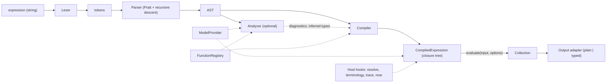

# Callis architecture

> Status: **accepted** (owner review, 2026-11-03). This is the big picture of Callis, a FHIRPath engine for TypeScript written from scratch and published as `@callis/core`. It is deliberately short: the reasons behind decisions live in [ADRs](adr/README.md), and the detailed design lives with the [task](roadmap.md) that implements it.

## How the documentation is organized

| Where | What |
| --- | --- |
| `docs/architecture.md` | This overview: goals, scope, pipeline, key decisions, layout. |
| [`docs/adr/`](adr/README.md) | One file per architecture decision (context, decision, consequences). |
| [`docs/roadmap.md`](roadmap.md) | Task index, dependency graph and suggested waves. |
| `docs/tasks/` | One file per task (`T0000-scaffold.md` …): goal, scope, design notes, acceptance criteria. A worker only needs its own task file plus the ADRs it links. |
| `docs/spec-notes.md` | Spec interpretations and suite-label exceptions (created by the first task that needs it). |
| `docs/conformance/` | Generated conformance reports (from T0022). |
| [`CONTRIBUTING.md`](../CONTRIBUTING.md), [`AGENTS.md`](../AGENTS.md) | How to work in the repository: workflow, PR titles, definition of done; agent rules. |
| [`docs/guides/`](guides/) | Code style and testing guides. |

**Rule:** design details belong in the task that implements them. Changing a decision means updating its ADR in the same PR.

## Normative references

| Reference | URL |
| --- | --- |
| FHIRPath N1 (2.0.0, normative release) | <https://hl7.org/fhirpath/N1/> |
| FHIRPath N1 grammar (ANTLR) | <https://hl7.org/fhirpath/N1/grammar.html> |
| FHIRPath 3.0.0 (STU release, July 2026, now "current") | <https://hl7.org/fhirpath/STU3/> ([change notes](https://hl7.org/fhirpath/STU3/changes.html)) |
| FHIRPath in FHIR R4 | <https://hl7.org/fhir/R4/fhirpath.html> |
| FHIRPath in FHIR R5 | <https://hl7.org/fhir/R5/fhirpath.html> |
| FHIR JSON format (primitive extensions, choice types) | <https://hl7.org/fhir/R4/json.html> |
| UCUM | <https://ucum.org/ucum> |
| Official test suite | <https://github.com/FHIR/fhir-test-cases/tree/master/r5/fhirpath> |

Links of the form `N1 §x` point into the N1 document, for example [N1 §4.5](https://hl7.org/fhirpath/N1/#singleton-evaluation-of-collections).

## Goals and non-goals

**Goals**

1. **Correctness first.** Behaviour follows the specification and is checked against the official HL7 FHIRPath test suite.
2. **No runtime dependencies** in `@callis/core`.
3. **Fast repeated evaluation.** Compile once, evaluate many times: search parameters, invariants, mappings.
4. **Runs anywhere.** The same ESM build works in Node.js, browsers, Deno, Bun and edge workers.
5. **Works without a model, better with one.** Plain JSON is enough to get started; a FHIR R4/R5 model adds choice types, type checks and primitive extensions.
6. **Precise values.** No binary floating point for `Decimal`. Dates keep partial precision. Quantities respect units.
7. **Good diagnostics.** Every error has a stable code and a source position.
8. **Strict TypeScript** and a fully typed public API.

**Non-goals (for now)**

- FHIR XML or RDF as input. JSON only; XML is used only inside the test tooling.
- Being a terminology server or a FHIR client. Callis exposes hooks; hosts implement them.
- CQL, FHIRPath Patch, SQL-on-FHIR. These may become separate packages later.
- Mutating input. FHIRPath has no side effects, except `trace()`.

## Specification baseline and scope

Phase 1 covers the **normative part of FHIRPath N1** plus the **FHIR-specific additions** (owner decision). The STU parts come in phase 2.

FHIRPath 3.0.0 (July 2026) is now the version served at <https://hl7.org/fhirpath/>. It keeps N1's normative content, marks additions as STU, and clarifies many normative rules. The official test suite follows it. **Where 3.0.0 clarifies normative behaviour, Callis follows 3.0.0 and the suite** ([ADR-0001](adr/0001-spec-baseline.md)). Each interpretation that is not obvious from the text is recorded in `docs/spec-notes.md`.

| Area | Phase 1 | Phase 2 (STU) | Notes |
| --- | :---: | :---: | --- |
| Full N1 grammar: literals, operators, invocations, `$this`, `$index`, `%vars`, comments | ✓ | | [N1 §4](https://hl7.org/fhirpath/N1/#expressions), [§8](https://hl7.org/fhirpath/N1/#lexical-elements) |
| Functions [N1 §5.1–5.6](https://hl7.org/fhirpath/N1/#existence), [§5.8](https://hl7.org/fhirpath/N1/#tree-navigation), [§5.9](https://hl7.org/fhirpath/N1/#utility-functions) | ✓ | | existence, filtering/projection, subsetting, combining, conversion, string, tree, utility |
| Math functions [N1 §5.7](https://hl7.org/fhirpath/N1/#math) | ✓ | | **STU in N1**, included by owner decision |
| Operations [N1 §6](https://hl7.org/fhirpath/N1/#operations), including date/time arithmetic | ✓ | | |
| Environment variables [N1 §9](https://hl7.org/fhirpath/N1/#environment-variables) | ✓ | | |
| `$total`, `aggregate()` [N1 §7](https://hl7.org/fhirpath/N1/#aggregates) | parse only | ✓ | STU |
| Reflection `type()` [N1 §10.2](https://hl7.org/fhirpath/N1/#reflection) | | ✓ | STU |
| `Long` type, `1L` literal, `toLong()` | | ✓ | 3.0.0 STU |
| Other [3.0.0](https://hl7.org/fhirpath/STU3/) additions (`sort`, `coalesce`, `defineVariable`, boundaries, date/time components, string additions, …) | | ✓ | see T0026–T0031 |
| FHIR variables: `%resource`, `%rootResource`, `%context`, `%ucum`, `%sct`, `%loinc`, `` %`vs-*` ``, `` %`ext-*` `` | ✓ | | [R5 §2.1.9.1.4](https://hl7.org/fhir/R5/fhirpath.html#variables), [§2.1.9.1.7](https://hl7.org/fhir/R5/fhirpath.html#vars) |
| FHIR functions: `extension()`, `hasValue()`, `getValue()`, `resolve()`, `ofType()`/`is`/`as` on FHIR types | ✓ | | [R5 §2.1.9.1.5](https://hl7.org/fhir/R5/fhirpath.html#functions) |
| FHIR functions backed by host hooks: `memberOf()`, `subsumes()`, `subsumedBy()`, `conformsTo()`, `htmlChecks()` | ✓ | | empty without a hook |
| FHIR equivalence changes (`Coding`, `CodeableConcept`, `id` ignored) | ✓ | | [R5 §2.1.9.1.6](https://hl7.org/fhir/R5/fhirpath.html#changes) |
| `elementDefinition()`, `slice()`, `checkModifiers()`; R5 draft APIs `%terminologies`, `%server`, `%factory` | | ✓ | T0032 |
| CDA logical model, "document functions" (HL7 Java extensions) | | | out of scope |

## Pipeline



| Stage | Responsibility | Details |
| --- | --- | --- |
| Lexer | Characters to tokens with exact spans. No semantics. | [T0001](tasks/T0001-lexer.md) |
| Parser | Tokens to AST. Syntax only; every node has a source span. | [T0002](tasks/T0002-parser.md) |
| Analyzer (optional) | Semantic checks and type inference, given a model and input type. Never changes the AST. | [T0024](tasks/T0024-static-analysis.md) |
| Compiler | AST to a tree of closures. Functions, type specifiers and literals are resolved once. | [T0008](tasks/T0008-compiler-evaluator.md) |
| Runtime | Evaluates the closure tree. Reentrant and safe for concurrent async evaluations. | [T0008](tasks/T0008-compiler-evaluator.md), [T0021](tasks/T0021-hooks-async.md) |
| Output adapter | Converts internal values to plain JSON-friendly values or typed values. | [T0025](tasks/T0025-public-api-release.md) |

Everything up to and including the compiler is pure and deterministic. The AST is plain, JSON-serializable data, so tools such as formatters and editor integrations can use it directly.

## Key decisions

| Topic | Decision | ADR |
| --- | --- | --- |
| Spec baseline | N1 normative + FHIR additions in phase 1, following 3.0.0 clarifications; Math included; STU in phase 2. | [0001](adr/0001-spec-baseline.md) |
| Parsing | Hand-written lexer; Pratt parser for operators, recursive descent for the rest. No parser generator. | [0002](adr/0002-hand-written-parser.md) |
| Evaluation | The AST is compiled once to a tree of closures. No `eval`/`new Function`, so it works under a strict CSP. | [0003](adr/0003-closure-compilation.md) |
| Sync and async | One closure tree returning `MaybePromise<Collection>`. `evaluate()` is sync; `evaluateAsync()` allows async hooks. Promises are detected structurally. | [0004](adr/0004-sync-core-async-path.md) |
| Decimal | Own `BigInt`-based implementation (coefficient + scale) that keeps precision. | [0005](adr/0005-bigint-decimal.md) |
| Date/time | Own partial-precision value types; no Temporal and no date library. | [0006](adr/0006-own-date-time-types.md) |
| Units | Minimal unit system in core; full UCUM in the opt-in `@callis/ucum`. | [0007](adr/0007-ucum-split.md) |
| Model | `ModelProvider` interface; the core also works on plain JSON. R4/R5 models are generated and published as separate packages. | [0008](adr/0008-model-provider.md) |
| Packaging | ESM only, ES2022, zero runtime dependencies, Node 22/24/26 and browsers. | [0009](adr/0009-esm-only-zero-deps.md) |
| Tooling | pnpm, TypeScript 7, tsdown, Biome, Vitest, Changesets. | [0010](adr/0010-tooling.md) |
| Conformance | Vendored HL7 test suite, run in CI with a baseline that may only ratchet upwards. | [0011](adr/0011-conformance-suite.md) |
| Defaults | UTC for date/time values without an offset; Decimal as `number` in plain output; strict choice types. | [0012](adr/0012-evaluation-defaults.md) |

## Values at a glance

Every expression evaluates to a **collection**: a read-only JavaScript array of items, never containing `null` or `undefined`. Items are represented like this:

| FHIRPath type | JavaScript representation | Details |
| --- | --- | --- |
| `System.Boolean`, `System.String` | `boolean`, `string` | [T0003](tasks/T0003-types-and-collections.md) |
| `System.Integer` | `number` (32-bit range) | [T0003](tasks/T0003-types-and-collections.md) |
| `System.Long` (phase 2) | `bigint` | [T0028](tasks/T0028-stu-long.md) |
| `System.Decimal` | `Decimal` (class) | [T0004](tasks/T0004-decimal.md) |
| `System.Date`, `System.DateTime`, `System.Time` | `DateValue`, `DateTimeValue`, `TimeValue` (classes) | [T0005](tasks/T0005-date-time.md) |
| `System.Quantity` | `Quantity` (class) | [T0006](tasks/T0006-quantity.md) |
| Model data: resources, complex types, FHIR primitives | `ModelNode` | [T0018](tasks/T0018-model-aware-evaluation.md) |

JavaScript primitives cover the most common types without wrappers, and dispatching on `typeof` and `instanceof` is cheap. Empty propagation, singleton evaluation and three-valued logic are described in [T0003](tasks/T0003-types-and-collections.md). Equality and equivalence for each type are in [T0009](tasks/T0009-equality-kernels.md).

## Public API at a glance

```ts
import { compile, evaluate, evaluateAsync, parse } from '@callis/core';
import { r4 } from '@callis/fhir-r4';
import { ucum } from '@callis/ucum';

const given = evaluate(patient, 'Patient.name.given');                     // one-off, cached

const isHigh = compile("Observation.value.ofType(Quantity) > 5 'mg/dL'", { model: r4, units: ucum });
isHigh.evaluate(observation);                                              // compile once, run many times

const names = await evaluateAsync(bundle, 'Bundle.entry.resource.subject.resolve().name', {
  model: r4,
  hooks: { resolve: (ref) => client.read(ref) },                           // I/O-backed hook
});

const ast = parse("name.where(use = 'official').given");                   // AST for tooling
```

The full sketch, including options, output modes and limits, is in [T0025](tasks/T0025-public-api-release.md#public-api-sketch). Errors are described in [T0000](tasks/T0000-scaffold.md#errors-and-diagnostics).

## Repository layout

```text
callis/
├── .changeset/
├── .github/workflows/          ci.yml (release.yml later)
├── docs/                       architecture.md, roadmap.md, adr/, tasks/, spec-notes.md, conformance/
├── packages/
│   ├── core/                   @callis/core    engine, no runtime dependencies
│   ├── ucum/                   @callis/ucum    UCUM unit system, no runtime dependencies
│   ├── fhir-r4/                @callis/fhir-r4 generated R4 ModelProvider
│   ├── fhir-r5/                @callis/fhir-r5 generated R5 ModelProvider
│   └── cli/                    @callis/cli     later
├── scripts/                    repository scripts: zero-dependency check, size report
├── tools/                      private, never published
│   ├── model-gen/              StructureDefinition → model data
│   └── conformance/            HL7 test-suite runner, vendored fixtures, baseline
├── biome.json
├── package.json                private root with workspace scripts
├── pnpm-workspace.yaml
├── tsconfig.base.json
└── vitest.config.ts            projects
```

```text
packages/core/src/
├── index.ts               public exports only
├── api/                   parse, analyze, compile, evaluate, evaluateAsync; options; output adapters; compile cache
├── errors/                FhirPathError hierarchy, error codes, SourceSpan, formatting
├── lexer/                 token.ts, lexer.ts, char-codes.ts, line-table.ts
├── parser/                ast.ts, parser.ts (Pratt), precedence.ts
├── analysis/              analyzer.ts, type-inference.ts, diagnostics.ts
├── compiler/              compile.ts (AST → closures), lambda.ts, maybe-promise.ts, constant-fold.ts
├── runtime/               context.ts (EvalContext, Frame), collection.ts, singleton.ts, logic.ts,
│                          equality.ts, comparison.ts, arithmetic.ts, navigation.ts, variables.ts
├── types/                 system-types.ts, type-specifier.ts, model-types.ts, conversions.ts, type-test.ts (is/as/ofType)
├── values/
│   ├── decimal/           decimal.ts, math.ts
│   ├── datetime/          date.ts, datetime.ts, time.ts, parse.ts, compare.ts, arithmetic.ts
│   ├── quantity/          quantity.ts, calendar-units.ts, unit-system.ts (interface + minimal implementation)
│   └── string.ts          equivalence normalization and helpers
├── model/                 model-provider.ts, model-node.ts, json-navigation.ts, primitive-extensions.ts, lossless-json.ts
├── functions/             registry.ts, define.ts, existence.ts, filtering.ts, subsetting.ts, combining.ts,
│                          conversion.ts, string.ts, math.ts, tree.ts, utility.ts
└── fhir/                  functions.ts, resolve.ts, variables.ts, equivalence.ts, hooks.ts
```

Tests live next to their sources (`*.test.ts`). Cross-module integration tests go in `packages/core/test/`.

**Module dependency rules** (enforced in review; a lint rule may come later). These rules are what let the first wave of the roadmap run in parallel:

- `errors` → nothing
- `lexer` → `errors`
- `parser` → `lexer`, `errors`
- `values/decimal`, `values/datetime`, `values/string` → `errors` only; pure and testable on their own
- `values/quantity` → `values/decimal`, `errors`. This one-way dependency is the only one allowed between value modules. No value module depends on `types`, `model` or `runtime`.
- `types` → `values`
- `model` → `types`, `values`
- `runtime` → `values`, `types`, `model`
- `functions`, `fhir` → `runtime`
- `compiler` → `parser` (AST types), `runtime`, `functions`
- `analysis` → `parser`, `types`, `model`, `functions`
- `api` → everything; `index.ts` → `api` plus public types

## Testing strategy

1. **Unit tests (Vitest)** live next to each module. Every example in the matching spec section becomes a table-driven test with a link to the spec anchor.
2. **Property-based tests** (`fast-check`, dev only):
   - `Decimal` against `decimal.js` as an oracle
   - date comparison laws
   - lexer and parser fuzzing: never crash, only throw `FhirPathSyntaxError`
3. **Conformance:** the official HL7 suite runs in CI with a ratcheting baseline and a published report ([ADR-0011](adr/0011-conformance-suite.md), [T0022](tasks/T0022-conformance-runner.md), [T0023](tasks/T0023-xml-fixture-conversion.md)).
4. **Type tests** (`expectTypeOf`) for the public API.
5. **Package checks:** publint, attw, the zero-dependency check and a size budget ([T0000](tasks/T0000-scaffold.md)).
6. **Later:** differential tests against `fhirpath.js` and benchmarks ([T0033](tasks/T0033-performance.md)).

Line coverage for the core (excluding generated code) is reported in CI with a target of 90% or more. It is not enforced at first.

## Security and robustness

- **Prototype safety:** navigation uses own-property checks (`Object.hasOwn`) and never reaches `__proto__`, `constructor` and similar. Internal maps use `Object.create(null)`.
- **No `eval` or `new Function`**, so Callis works under a strict CSP.
- **Regular expressions:** `matches()` and `replaceMatches()` run user-supplied patterns on JavaScript's backtracking engine, so ReDoS is possible. This is documented, and a `regex` hook lets hosts plug in a safe engine ([T0021](tasks/T0021-hooks-async.md)).
- **Bounded work:**
  - parsing has a maximum nesting depth
  - `repeat()` deduplicates per the spec, which only guarantees termination for projections that navigate a finite input tree. A value-generating projection such as `'x'.repeat($this & 'x')` never runs out of new items.
  - every evaluation therefore has finite default limits (`limits.maxRepeatItems`, `limits.maxCollectionSize`), and exceeding them raises `eval/limit-exceeded` in both sync and async mode ([T0012](tasks/T0012-fn-filtering.md), [T0025](tasks/T0025-public-api-release.md#public-api-sketch))
  - async evaluations can be cancelled with a signal ([T0021](tasks/T0021-hooks-async.md#sync-and-async))
- **Errors** never include input data beyond the expression text, so diagnostics are safe to log.

## Owner decisions

The open questions from the first draft were answered by the owner on 2026-11-03:

| Question | Decision | Recorded in |
| --- | --- | --- |
| Spec baseline | Follow FHIRPath 3.0.0's clarifications of normative behaviour. | [ADR-0001](adr/0001-spec-baseline.md) |
| Math functions (STU in N1) | Included in phase 1. | [ADR-0001](adr/0001-spec-baseline.md) |
| Module format | ESM only; no CommonJS build for now. | [ADR-0009](adr/0009-esm-only-zero-deps.md) |
| UCUM | Separate opt-in `@callis/ucum`, published only after a check of the UCUM data license. | [ADR-0007](adr/0007-ucum-split.md), [T0007](tasks/T0007-ucum.md) |
| Decimal in plain output | `number` by default; `decimalOutput: 'string'` and `output: 'typed'` for exact results. | [ADR-0012](adr/0012-evaluation-defaults.md) |
| Default timezone | **UTC** for values without an offset; `timezoneOffset` overrides it, and `'local'` uses the host's offset. | [ADR-0012](adr/0012-evaluation-defaults.md) |
| Choice-type suffixes (`Observation.valueQuantity`) | Rejected by default as the spec requires; `lenient: { choiceSuffix: true }` accepts them. | [ADR-0012](adr/0012-evaluation-defaults.md) |
| Package names and npm scope | `@callis/fhir-r4` and `@callis/fhir-r5`; the `@callis` scope is secured. | [ADR-0008](adr/0008-model-provider.md) |

New questions go into the relevant task file or a new ADR.
