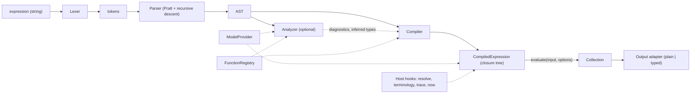

# Callis architecture

> Status: **draft for review**. This document describes the target architecture of Callis, a FHIRPath engine for TypeScript written from scratch and published as `@callis/core`.
> The work is broken into tasks in [roadmap.md](roadmap.md). Key decisions are recorded as short ADRs in [§21](#21-architecture-decision-records). Open questions for the owner are listed in [§22](#22-open-questions).

## Contents

1. [Goals and non-goals](#1-goals-and-non-goals)
2. [Specification baseline and scope](#2-specification-baseline-and-scope)
3. [Pipeline overview](#3-pipeline-overview)
4. [Lexer](#4-lexer)
5. [Parser and AST](#5-parser-and-ast)
6. [Static analysis (optional)](#6-static-analysis-optional)
7. [Evaluator: compiling to closures](#7-evaluator-compiling-to-closures)
8. [Values and types](#8-values-and-types)
9. [Decimal](#9-decimal)
10. [Date, DateTime and Time](#10-date-datetime-and-time)
11. [Quantity and UCUM](#11-quantity-and-ucum)
12. [Model abstraction](#12-model-abstraction)
13. [Environment variables, context and host hooks](#13-environment-variables-context-and-host-hooks)
14. [Function library](#14-function-library)
15. [Errors and diagnostics](#15-errors-and-diagnostics)
16. [Public API sketch](#16-public-api-sketch)
17. [Build, packaging and runtime targets](#17-build-packaging-and-runtime-targets)
18. [Repository layout](#18-repository-layout)
19. [Testing strategy](#19-testing-strategy)
20. [Security and robustness](#20-security-and-robustness)
21. [Architecture decision records](#21-architecture-decision-records)
22. [Open questions](#22-open-questions)

### Normative references

| Reference | URL |
| --- | --- |
| FHIRPath N1 (2.0.0, normative release) | <https://hl7.org/fhirpath/N1/> |
| FHIRPath N1 grammar (ANTLR) | <https://hl7.org/fhirpath/N1/grammar.html> |
| FHIRPath 3.0.0 (STU release, July 2026, now "current") | <https://hl7.org/fhirpath/STU3/> ([change notes](https://hl7.org/fhirpath/STU3/changes.html)) |
| FHIRPath in FHIR R4 | <https://hl7.org/fhir/R4/fhirpath.html> |
| FHIRPath in FHIR R5 | <https://hl7.org/fhir/R5/fhirpath.html> |
| FHIR JSON format (primitive extensions, choice types) | <https://hl7.org/fhir/R4/json.html> |
| UCUM | <https://ucum.org/ucum> |
| Official test suite | <https://github.com/FHIR/fhir-test-cases/tree/master/r5/fhirpath> |

Links of the form `N1 §x` point into the N1 document, for example [N1 §4.5](https://hl7.org/fhirpath/N1/#singleton-evaluation-of-collections).

---

## 1. Goals and non-goals

**Goals**

1. **Correctness first.** Behaviour follows the specification and is checked against the official HL7 FHIRPath test suite.
2. **No runtime dependencies** in `@callis/core`.
3. **Fast repeated evaluation.** Compile once, evaluate many times: search parameters, invariants, mappings.
4. **Runs anywhere.** The same ESM build works in Node.js, browsers, Deno, Bun and edge workers.
5. **Works without a model, better with one.** Plain JSON is enough to get started; a FHIR R4/R5 model adds choice types, type checks and primitive extensions.
6. **Precise values.** No binary floating point for `Decimal`. Dates keep partial precision. Quantities respect units.
7. **Good diagnostics.** Every error has a stable code and a source position.
8. **Strict TypeScript** and a fully typed public API.

**Non-goals (for now)**

- FHIR XML or RDF as input. JSON only; XML is used only inside the test tooling.
- Being a terminology server or a FHIR client. Callis exposes hooks; hosts implement them.
- CQL, FHIRPath Patch, SQL-on-FHIR. These may become separate packages later.
- Mutating input. FHIRPath has no side effects, except `trace()`.

---

## 2. Specification baseline and scope

The owner has decided that phase 1 covers the **normative part of FHIRPath N1** plus the **FHIR-specific additions**. The STU parts come in a later phase.

Since then, FHIRPath 3.0.0 was published (July 2026) and is now the version served at <https://hl7.org/fhirpath/>. It keeps the N1 normative content, marks all additions as STU, and clarifies many normative rules (singleton evaluation, `iif()` laziness, rounding of negative numbers, collection equality, date/time arithmetic edge cases). The official test suite (`tests-fhir-r5.xml` is the source of truth) already reflects these clarifications.

**Baseline rule ([ADR-001](#adr-001-specification-baseline)):** implement the N1 normative content. Where 3.0.0 clarifies normative behaviour, follow 3.0.0 and the test suite. Each interpretation that is not obvious from the text is recorded in `docs/spec-notes.md` (created by the first task that needs it), with a spec link and the relevant test names.

### Scope by phase

| Area | Phase 1 | Phase 2 (STU) | Notes |
| --- | :---: | :---: | --- |
| Full N1 grammar: literals, operators, invocations, `$this`, `$index`, `%vars`, comments | ✓ | | [N1 §4](https://hl7.org/fhirpath/N1/#expressions), [§8](https://hl7.org/fhirpath/N1/#lexical-elements) |
| Functions [N1 §5.1–5.6](https://hl7.org/fhirpath/N1/#existence), [§5.8](https://hl7.org/fhirpath/N1/#tree-navigation), [§5.9](https://hl7.org/fhirpath/N1/#utility-functions) | ✓ | | existence, filtering/projection, subsetting, combining, conversion, string, tree, utility |
| Math functions [N1 §5.7](https://hl7.org/fhirpath/N1/#math) | ✓ | | **STU in N1**, but explicitly in the owner's scope; small and heavily tested |
| Operations [N1 §6](https://hl7.org/fhirpath/N1/#operations), including date/time arithmetic | ✓ | | |
| Environment variables [N1 §9](https://hl7.org/fhirpath/N1/#environment-variables) | ✓ | | |
| `$total`, `aggregate()` [N1 §7](https://hl7.org/fhirpath/N1/#aggregates) | parse only | ✓ | STU |
| Reflection `type()` [N1 §10.2](https://hl7.org/fhirpath/N1/#reflection) | | ✓ | STU |
| `Long` type, `1L` literal, `toLong()` | | ✓ | 3.0.0 STU |
| 3.0.0 additions: `sort`, `coalesce`, `repeatAll`, `defineVariable`, `combine(preserveOrder)`, `lastIndexOf`, `matchesFull`, regex flags, `encode`/`decode`/`escape`/`unescape`/`trim`/`split`/`join`, `sum`/`min`/`max`/`avg`, `lowBoundary`/`highBoundary`/`precision`, date/time component functions, `duration`/`difference`, `comparable`, `pathname`, date/time subtraction, instance selector | | ✓ | [3.0.0](https://hl7.org/fhirpath/STU3/) |
| FHIR variables: `%resource`, `%rootResource`, `%context`, `%ucum`, `%sct`, `%loinc`, `` %`vs-*` ``, `` %`ext-*` `` | ✓ | | [R5 §2.1.9.1.4](https://hl7.org/fhir/R5/fhirpath.html#variables), [§2.1.9.1.7](https://hl7.org/fhir/R5/fhirpath.html#vars) |
| FHIR functions: `extension()`, `hasValue()`, `getValue()`, `resolve()`, `ofType()`/`is`/`as` on FHIR types | ✓ | | [R5 §2.1.9.1.5](https://hl7.org/fhir/R5/fhirpath.html#functions) |
| FHIR functions backed by host hooks: `memberOf()`, `subsumes()`, `subsumedBy()`, `conformsTo()`, `htmlChecks()` | ✓ | | the default without a hook is empty |
| FHIR equivalence changes (`Coding`, `CodeableConcept`, `id` ignored) | ✓ | | [R5 §2.1.9.1.6](https://hl7.org/fhir/R5/fhirpath.html#changes) |
| FHIR functions needing StructureDefinitions: `elementDefinition()`, `slice()`, `checkModifiers()` | | ✓ | needs richer model metadata |
| FHIR R5 draft APIs: `%terminologies`, `%server`, `%factory` | | ✓ | maturity 0 in R5; hook-based |
| CDA logical model, "document functions" (HL7 Java extensions) | | | out of scope |

---

## 3. Pipeline overview



| Stage | Input → output | Responsibility |
| --- | --- | --- |
| Lexer | `string` → tokens | Characters to tokens. No semantics. |
| Parser | tokens → AST | Syntax only. Every node has a source span. |
| Analyzer (optional) | AST + registry (+ model, input type) → diagnostics | Semantic checks and type inference. Never changes the AST. |
| Compiler | AST + registry (+ analysis) → closure tree | Resolves functions, type specifiers and literals once. Folds constants. |
| Runtime | closure tree + input + options → collection | Evaluates. Reentrant and safe for concurrent async evaluations. |
| Output adapter | collection → `unknown[]` or typed values | Converts internal values to what the caller asked for. |

Everything up to and including the compiler is pure and deterministic. The AST is plain, JSON-serializable data, so tools such as formatters, linters and editor integrations can use it directly.

---

## 4. Lexer

The lexer is hand-written ([ADR-002](#adr-002-hand-written-lexer-and-pratt-parser)). It makes one pass over the UTF-16 string, switching on character codes; the hot path has no regular expressions.

- **Tokens** carry `kind`, `start` and `end` offsets. Line and column are computed lazily from a line table, only when an error is formatted.
- **Trivia:** whitespace, `//` line comments and `/* */` block comments are skipped. An `includeTrivia` option keeps them for tooling.
- **Identifiers:** simple identifiers (`[A-Za-z_][A-Za-z0-9_]*`) and delimited identifiers in backticks, which support the same escapes as strings ([N1 §8.6](https://hl7.org/fhirpath/N1/#identifiers)).
- **Keywords** are lexed as identifiers, and the parser decides what they mean. This is because `as`, `contains`, `in` and `is` are also legal identifiers, while `div`, `mod`, `and` and the others are reserved ([N1 §8.5](https://hl7.org/fhirpath/N1/#keywords)). Calendar unit keywords (`year`, `months`, …) work the same way.
- **Strings:** single quotes, with escapes `\'`, `\"`, `` \` ``, `\\`, `\/`, `\f`, `\n`, `\r`, `\t` and `\uXXXX` ([N1 §4.1.2](https://hl7.org/fhirpath/N1/#string)).
- **Numbers:** `[0-9]+('.'[0-9]+)?`. Leading zeros are allowed. A `.` that is not followed by a digit ends the number, so `1.toString()` lexes as `1`, `.`, `toString`. The `L` suffix for `Long` (phase 2) is anticipated.
- **Date/time literals:** the `@` forms from the grammar (`DATE`, `DATETIME` including `@2015T`, `TIME` as `@T…`). The lexer checks only the shape; range checks (month 13, Feb 30) happen when the compiler builds the literal value.
- **Symbols:** `( ) [ ] { } . , = != ~ !~ < <= > >= + - * / | &`, `$this`, `$index`, `$total` and `%`.
- **Environment variable names:** after `%` come an identifier, a delimited identifier, or a string (`%'us-zip'`, allowed for backwards compatibility per [N1 §9](https://hl7.org/fhirpath/N1/#environment-variables)). The double-quoted form `%"vs-name"` that appears on the FHIR pages is accepted as a documented compatibility extension.
- **Errors:** unterminated string, identifier or comment; invalid escape; unexpected character; malformed date literal. Each raises `FhirPathSyntaxError` with a span.

---

## 5. Parser and AST

A **Pratt parser** handles prefix and infix operators. Plain **recursive descent** handles terms, invocations, argument lists and type specifiers ([ADR-002](#adr-002-hand-written-lexer-and-pratt-parser)).

### 5.1 Binding powers

These follow [N1 §6.8](https://hl7.org/fhirpath/N1/#operator-precedence) and the ANTLR grammar. All binary operators are left-associative.

| Binding power | Operators | Kind |
| ---: | --- | --- |
| 13 (highest) | `.` invocation | postfix |
| 12 | `[ ]` indexer | postfix |
| 11 | unary `+`, `-` | prefix |
| 10 | `*`, `/`, `div`, `mod` | infix |
| 9 | `+`, `-`, `&` | infix |
| 8 | `is`, `as` (right side is a type specifier) | infix |
| 7 | `\|` | infix |
| 6 | `<`, `>`, `<=`, `>=` | infix |
| 5 | `=`, `~`, `!=`, `!~` | infix |
| 4 | `in`, `contains` | infix |
| 3 | `and` | infix |
| 2 | `or`, `xor` | infix |
| 1 | `implies` | infix |

Rules worth calling out:

- **Unary minus binds looser than `.`**, so `-1.convertsToInteger()` parses as `-(1.convertsToInteger())`, as in the N1 §6.8 example. The AST stays faithful to this; the compiler folds `-<number literal>` into a negative literal.
- **`is` / `as` read a qualified identifier greedily.** `x as Quantity.unit` names the type `Quantity.unit`, so authors must write `(x as Quantity).unit`. This matches the ANTLR grammar.
- The function forms `is(T)`, `as(T)` and `ofType(T)` parse their argument as an expression. The compiler then reads it as a type specifier: an identifier or a chain of member accesses.
- `NUMBER` followed by a `STRING` or a calendar keyword becomes a `Quantity` literal. `{}` is the empty literal.
- `as`, `contains`, `in` and `is` are accepted where an identifier is expected, as in `'abc'.contains('b')`.
- A leading identifier is parsed as a plain `Identifier`. Whether it names a type (such as `Patient`) or a path is decided later ([§12.5](#125-navigation-rules)).
- **Nesting limit:** a maximum depth (default 1,000) prevents stack overflows on hostile input.
- The parser stops at the **first error**. Error recovery for editor use may come later.

### 5.2 AST

The AST is a discriminated union. Every node has `span: { start: number; end: number }`.

```ts
type ExpressionNode =
  | LiteralNode          // { kind: 'Literal', type: 'Boolean' | 'String' | 'Integer' | 'Decimal' | 'Date' | 'DateTime' | 'Time' | 'Quantity' | 'Empty', raw: string, unit?: string }
  | IdentifierNode       // { kind: 'Identifier', name, delimited }       — root-level member or type name
  | MemberNode           // { kind: 'Member', target, name, delimited }   — a.b
  | FunctionCallNode     // { kind: 'FunctionCall', target | null, name, args }
  | IndexerNode          // { kind: 'Indexer', target, index }
  | UnaryNode            // { kind: 'Unary', op: '+' | '-', operand }
  | BinaryNode           // { kind: 'Binary', op, left, right }
  | TypeOperationNode    // { kind: 'TypeOperation', op: 'is' | 'as', operand, type: TypeSpecifier }
  | VariableNode         // { kind: 'Variable', name }                    — %name
  | ThisNode | IndexNode | TotalNode;                                   // $this, $index, $total
```

Literal nodes keep the **raw source text**. The compiler converts it with the value modules. This keeps the parser independent of the `Decimal` and date/time implementations, so they can be built in parallel, and it preserves decimal precision (`1.0` vs `1`).

The AST is part of the public API (`parse()`), but its shape is not frozen before 1.0.

---

## 6. Static analysis (optional)

Analysis runs at three levels:

1. **Always, as part of `compile()`.** Is the function known? Is its arity right? Are lambda and type-specifier arguments where they should be? Are literal values valid? Is `$total` used outside `aggregate()`? Failures throw `FhirPathSemanticError`.
2. **Model-aware**, opt-in with `model` + `inputType`. Type inference over the AST: every node gets a set of possible types and a cardinality (`0..1` or `0..*`). This catches:
   - unknown elements (`name.given1`)
   - choice elements used with a type suffix (`Observation.valueQuantity`), with the hint "use `value.ofType(Quantity)`"
   - a root type that does not match the input (`Encounter.name` on a Patient)
   - unknown types in `is`/`as`/`ofType`
   - obvious operator type errors (`1 + 'a'`)
3. **Strict mode** (`strict: true`, [N1 §11](https://hl7.org/fhirpath/N1/#type-safety-and-strict-evaluation)). Warnings become errors for operations that are unsafe on singletons, such as `=` on a path that can repeat. The basic version comes in phase 1; the full version later.

The result is a list of `Diagnostic { severity: 'error' | 'warning'; code; message; span }`. `compile()` throws on errors; `analyze()` returns the diagnostics without throwing, for tooling. The test suite's `invalid="semantic"` cases and `mode="strict"` tests are covered by levels 2 and 3.

---

## 7. Evaluator: compiling to closures

**Decision ([ADR-003](#adr-003-compile-the-ast-to-closures)):** `compile()` turns the AST into a tree of JavaScript closures once. Evaluating means calling the root closure.

```ts
type Collection = readonly Item[];
type Evaluator = (ctx: EvalContext, focus: Collection, frame: Frame) => MaybePromise<Collection>;

function compileNode(node: ExpressionNode, cc: CompileContext): Evaluator {
  switch (node.kind) {
    case 'Member': {
      const target = compileNode(node.target, cc);
      const name = node.name; // resolved once
      return (ctx, focus, frame) => then(target(ctx, focus, frame), (input) => navigate(ctx, input, name));
    }
    case 'FunctionCall': {
      const fn = cc.registry.resolve(node.name, node.args.length, node.span); // lookup and arity check once
      // ...
    }
    // ...
  }
}
```

- **Done once, at compile time:** function lookup and arity check; choosing the operator implementation; building literal values (`Decimal`, dates, quantities); resolving type specifiers against the model; folding side-effect-free constant subtrees (for example `-1` or `'a' & 'b'`).
- **`EvalContext`** is created per evaluation. It holds the input (`%context`), `%resource`, `%rootResource`, variables, model, unit system, hooks, a snapshot of `now`, the timezone policy, the output mode, and an `AbortSignal`.
- **`Frame`** holds the iteration variables `$this`, `$index` and `$total`. Frames are passed as parameters and chained for nested lambdas, never stored globally. That keeps a compiled expression reentrant and safe for concurrent async evaluations.
- **Higher-order functions** (`where`, `select`, `all`, `exists(criteria)`, `repeat`, `iif`, and later `aggregate`, `sort`, `defineVariable`) receive their lambda arguments as compiled closures, not as evaluated values. The function definition declares which parameters are lambdas.
- **Errors** carry the span of the node that failed. Spans are attached at operator and function-call boundaries, not on every node, to keep the hot path cheap.
- **Generating JavaScript source** (`new Function`) was rejected: it breaks under a Content-Security-Policy without `unsafe-eval` and is harder to debug.

---

## 8. Values and types

### 8.1 Collections

- Every expression evaluates to a **collection**: a JavaScript array `readonly Item[]`. Empty is `[]`. Collections never contain `null` or `undefined`.
- Collections are **never mutated** after they are returned (enforced by `readonly` types). Builders use local mutable arrays. A shared frozen `EMPTY` constant avoids allocations.
- **Order** is preserved wherever the spec defines it (navigation, `combine`, indexers). Where the spec leaves order undefined (for example the `|` operator, [N1 §6.4.1](https://hl7.org/fhirpath/N1/#union-collections)), Callis still produces a deterministic order: left items first, then new items from the right.

### 8.2 How items are represented

| FHIRPath type | JavaScript representation | Notes |
| --- | --- | --- |
| `System.Boolean` | `boolean` | |
| `System.String` | `string` | |
| `System.Integer` | `number` | Always an integer in 32-bit range ([N1 §4.1.3](https://hl7.org/fhirpath/N1/#integer)). Overflow handling is recorded in `spec-notes.md`. |
| `System.Long` (phase 2) | `bigint` | |
| `System.Decimal` | `Decimal` (class) | [§9](#9-decimal) |
| `System.Date`, `System.DateTime`, `System.Time` | `DateValue`, `DateTimeValue`, `TimeValue` (classes) | [§10](#10-date-datetime-and-time) |
| `System.Quantity` | `Quantity` (class) | [§11](#11-quantity-and-ucum) |
| Model data: resources, complex types, FHIR primitives | `ModelNode` | [§12.3](#123-modelnode) |

JavaScript primitives cover the three most common types without wrappers. Dispatching on `typeof` and `instanceof` is cheap. `ModelNode` is used only for data that comes from the input.

### 8.3 Type system

- A type is named by `{ namespace, name }`. The System types are `Any`, `Boolean`, `String`, `Integer`, `Long` (phase 2), `Decimal`, `Date`, `DateTime`, `Time` and `Quantity`, all derived from `System.Any`.
- **Resolving type specifiers** ([N1 §10.1](https://hl7.org/fhirpath/N1/#models)): an unqualified name is looked up in the model namespace first (for example `FHIR`), then in `System`. Qualified names (`FHIR.Patient`, `System.String`) are looked up directly.
- **`is`, `as` and `ofType`** accept the exact type or a subtype, using model inheritance. FHIR primitives follow the FHIR rules ([R5 §2.1.9.1.2](https://hl7.org/fhir/R5/fhirpath.html#types)): `Patient.birthDate is date` is true and `is System.Date` is false. `ofType()` accepts both.
- **Implicit conversions** ([N1 §5.5](https://hl7.org/fhirpath/N1/#conversion)): `Integer → Decimal`, `Integer → Quantity`, `Decimal → Quantity`, `Date → DateTime`. Phase 2 adds `Integer → Long` and `Long → Decimal`.
- **FHIR primitives map to System types** using the table on the FHIR page, with one deliberate difference: `FHIR.date` maps to `System.Date`, not `System.DateTime`. The test suite expects this (`birthDate` has output type `date`), and so do the other major implementations. `FHIR.Quantity` maps to `System.Quantity` only when it has a UCUM system and code ([R5 §2.1.9.1.3](https://hl7.org/fhir/R5/fhirpath.html#quantity)).
- **Explicit conversions** are the `toX()` and `convertsToX()` functions.
- **Model-less convenience:** a string that comes from untyped input data (not a string literal) is parsed on demand when it is compared with a date/time value. So `birthDate = @1974-12-25` works without a model. This rule is documented and tested, and it never applies when a model is present.

### 8.4 Empty propagation and singleton evaluation

- **Operators:** an empty operand gives an empty result ([N1 §4.4.1](https://hl7.org/fhirpath/N1/#propagation-of-empty-results-in-expressions)). Exceptions follow the spec: Boolean operators use three-valued logic, `|`, `in` and `contains` have their own rules, `{} ~ {}` is `true`, and `&` treats empty as `''`.
- **Functions** define their own behaviour for empty input. Most return empty.
- **Singleton evaluation** ([N1 §4.5](https://hl7.org/fhirpath/N1/#singleton-evaluation-of-collections)) is one helper, `singleton(collection, expectedType)`, that implements the four-step rule:
  1. A single item that converts to the expected type is that value.
  2. A single item where a `Boolean` is expected is `true`.
  3. An empty collection stays empty.
  4. Anything else raises the error code `eval/singleton-expected`.
- **Boolean contexts** (`where` criteria, `iif` criteria, operands of `and`/`or`) use the same helper, producing `true`, `false` or empty.

### 8.5 Three-valued logic

`and`, `or`, `xor`, `implies` and `not()` follow the truth tables in [N1 §6.5](https://hl7.org/fhirpath/N1/#boolean-logic), implemented over `true | false | undefined` (where `undefined` means empty). Both operands are always evaluated. The spec says short-circuiting must not change semantics, and an error in the right operand has to surface even when the left operand already decides the result. `iif()` is the lazy construct.

### 8.6 Equality and equivalence

The equality kernel returns `true | false | undefined` (undefined means "cannot be determined"). The comparison kernel returns `-1 | 0 | 1 | undefined`. Operators and collection functions build on these kernels.

| Type | `=` ([N1 §6.1.1](https://hl7.org/fhirpath/N1/#equals)) | `~` ([N1 §6.1.2](https://hl7.org/fhirpath/N1/#equivalent)) |
| --- | --- | --- |
| Either operand empty | empty | `{} ~ {}` is `true`; empty against non-empty is `false` |
| String | exact, case-sensitive | ignores case and locale, normalizes whitespace ([string equivalence](https://hl7.org/fhirpath/N1/#string-equivalence)) |
| Integer / Decimal | numeric value; trailing zeros ignored; Integer is converted to Decimal | compared after rounding to the precision of the less precise operand |
| Boolean | value | value |
| Date / DateTime / Time | compare precision by precision; a precision present on one side only gives empty; seconds and milliseconds count as one decimal precision; timezone offsets are respected ([§10](#10-date-datetime-and-time)) | different precision gives `false` |
| Quantity | same dimension, converted via the unit system; calendar and definite durations above seconds are unequal ([N1 quantity equality](https://hl7.org/fhirpath/N1/#quantity-equality)) | calendar ↔ definite allowed per the table in [N1 §4.1.8](https://hl7.org/fhirpath/N1/#time-valued-quantities) (`1 year ~ 1 'a'`) |
| Complex model data | all child properties equal, recursively | FHIR: `id` ignored; `Coding` compared on `system` + `code`; `CodeableConcept` equivalent if any of their codings are ([R5 §2.1.9.1.6](https://hl7.org/fhir/R5/fhirpath.html#changes)) |
| Collections with several items | same length, pairwise equal in order | same length, matched regardless of order |

`!=` is `not(=)` and `!~` is `not(~)`. The collection functions (`distinct`, `isDistinct`, `union`, `intersect`, `exclude`, `subsetOf`, `supersetOf`, `in`, `contains`) use `=` semantics. Each function decides how to treat an undetermined comparison; for example, `@2020.combine(@2020-01-01).isDistinct()` is empty in the test suite.

### 8.7 Ordering

`<`, `>`, `<=` and `>=` ([N1 §6.2](https://hl7.org/fhirpath/N1/#comparison)) are defined for Integer, Decimal, String (by Unicode code point), Date, DateTime, Time and Quantity (with comparable units). Mixing incompatible types is an error. Partial-precision dates can give empty. Phase 2's `sort()` reuses the same kernel.

---

## 9. Decimal

**Decision ([ADR-005](#adr-005-own-bigint-based-decimal)):** Callis implements its own `Decimal`, backed by `BigInt`, with no dependency.

```ts
class Decimal {                  // immutable
  readonly coefficient: bigint;  // value = coefficient × 10^-scale
  readonly scale: number;        // number of digits after the decimal point, ≥ 0
}
```

**Requirements** ([N1 §4.1.4](https://hl7.org/fhirpath/N1/#decimal)): at least 28 digits with 8 decimal places, a fixed-precision representation, and **visible precision**: `1.0.toString()` is `'1.0'`, and `~` and phase 2's `precision()`/`lowBoundary()` depend on the scale. A JavaScript `number` fails all of these (`0.1 + 0.2`, losing `1.0`, the 2^53 limit).

**Semantics**

- `+` and `-` are exact, with scale `max(a.scale, b.scale)`. `*` is exact, with scale `a.scale + b.scale`.
- `/` always returns a Decimal ([N1 §6.6.2](https://hl7.org/fhirpath/N1/#division)). The quotient is computed to 28 significant digits (at least 8 fractional digits) and trailing zeros are removed. Division by zero returns empty.
- `div`, `mod`, `round`, `truncate`, `floor`, `ceiling` and `abs` are exact. `round()` rounds half away from zero (`0.5 → 1`, `-0.5 → -1`), as clarified in [3.0.0](https://hl7.org/fhirpath/STU3/).
- `sqrt`, `exp`, `ln`, `log`, and `power` with a non-integer exponent go through `number` and `Math.*`, and the result is rounded to 15 significant digits. This precision loss is documented. Integer powers are exact.
- Comparison aligns scales. Literals and parsed values keep their scale.
- A `number` from `JSON.parse` is converted through its shortest round-trip string. The original precision is already lost at that point, which is why [§12.7](#127-lossless-decimals-in-json-input) offers a lossless JSON parser.
- The tests include property-based checks against `decimal.js`, used only as a dev-time oracle.

---

## 10. Date, DateTime and Time

**Decision ([ADR-006](#adr-006-own-datetime-value-types)):** Callis has its own small immutable value types, with no date library and no Temporal.

```ts
type Precision = 'year' | 'month' | 'day' | 'hour' | 'minute' | 'second' | 'millisecond';

class DateTimeValue {
  readonly year: number;
  readonly month?: number;  readonly day?: number;
  readonly hour?: number;   readonly minute?: number;
  readonly second?: number; readonly millisecond?: number;
  readonly precision: Precision;
  readonly offsetMinutes?: number;   // undefined = no timezone; 'Z' = 0
}
// DateValue: year..day. TimeValue: hour..millisecond, no timezone (N1 §4.1.6).
```

**Parsing** covers FHIRPath literals (`@2014-01-25T14:30:14.559+01:00`, `@T14:30`, `@2015T`), FHIR JSON strings (`date`, `dateTime`, `instant`, `time`), and string input to `toDate()`, `toDateTime()` and `toTime()`. Values are validated: month 1–12, days per month including leap years, hour 0–23, minutes and seconds 0–59, offset within ±14:00. Fractional seconds beyond milliseconds (allowed in FHIR `instant`) are truncated to milliseconds, which is the minimum precision required by [N1 §4.1.7](https://hl7.org/fhirpath/N1/#datetime).

**Comparison and equality** ([N1 §6.1.1, Date/Time equality](https://hl7.org/fhirpath/N1/#datetime-equality)):

1. If both values have a timezone offset, both are normalized to UTC.
2. If only one has an offset, the evaluation's **default offset** is applied to the other. The `timezoneOffset` option controls this; the default is the host's local offset at the evaluation's `now`. N1 leaves this to the implementation and suggests the server's local offset.
3. Components are compared from the year down. If one side lacks a component the other has, the result is undetermined (empty). Seconds and milliseconds are compared as one decimal value.
4. For equivalence (`~`), different precision gives `false`.

**Arithmetic** ([N1 §6.7](https://hl7.org/fhirpath/N1/#datetime-arithmetic)):

- `+` and `-` take time-valued quantities and use calendar semantics.
  - The fixed-length UCUM units `'wk'`, `'d'`, `'h'`, `'min'`, `'s'` and `'ms'` are accepted and behave like `week`, `day`, `hour`, `minute`, `second` and `millisecond`.
  - Only the variable-length UCUM units `'a'` and `'mo'` raise an error; authors must write `year` or `month` instead. N1 forbade every definite duration above seconds, but 3.0.0's date/time arithmetic table narrows the error to `'a'` and `'mo'`, and the suite agrees (`testPlusDate13`/`15`/`21`/`22` succeed, `testPlusDate14`/`16` fail).
  - Units that are not time units (`'cm'`) raise an error (`testMinus6`).
  - The suite also accepts a calendar keyword written as a quoted unit (`@1974-12-25 - 1 'month'`, `testMinus5`, marked "contested"). Callis follows it and records this in `spec-notes.md`.
- When adding months or years lands on an invalid day, it is clamped to the last day of the month (`@2020-01-31 + 1 month = @2020-02-29`).
- For partial values, the quantity is converted to the value's precision and truncated: `@2014 + 23 months = @2015`.
- The allowed units depend on the value type: Date takes year to day; Time takes hour to millisecond.

**Current time:** `now()`, `today()` and `timeOfDay()` are captured **once per evaluation**, as [N1 §5.9.2](https://hl7.org/fhirpath/N1/#current-date-and-time-functions) requires. Hosts can inject `now` for deterministic tests.

---

## 11. Quantity and UCUM

`Quantity` is `{ value: Decimal; unit: string }`. The unit is either a UCUM code (from a string literal such as `'mg'`) or a calendar duration keyword. Plural keywords are normalized to singular. FHIR `Quantity` values are mapped as described in [§8.3](#83-type-system).

These operations need unit knowledge:

- equality, equivalence and ordering (conversion to a common unit)
- `+` and `-` (same dimension)
- `*` and `/` (unit algebra, as in `12 'cm2' / 3 'cm' = 4.0 'cm'`)
- `toQuantity(unit)`
- date/time arithmetic

**Decision ([ADR-007](#adr-007-ucum-minimal-unit-system-in-core-full-ucum-in-callisucum)):**

- **`@callis/core`** defines a `UnitSystem` interface and ships a **minimal built-in unit system**. It covers identical units, the calendar keywords, the UCUM time units `ms`, `s`, `min`, `h`, `d`, `wk`, `mo` and `a`, and the calendar ↔ definite duration table. This meets the spec's minimum: implementations "must at least respect units, recognizing when units differ" ([N1 quantity equality](https://hl7.org/fhirpath/N1/#quantity-equality)). Units the minimal system cannot relate compare as empty.
- **`@callis/ucum`** is a separate package, also without runtime dependencies. It provides full UCUM conversion: a parser for UCUM unit expressions (prefixes, atoms, exponents, `.` and `/`, `{annotations}`, `10*n` factors) plus tables generated from [`ucum-essence.xml`](https://github.com/ucum-org/ucum), with exact `Decimal` factors and dimension vectors. A small, explicit set of special (non-ratio) units such as `Cel` and `[degF]` is supported; other special units report "not convertible". Users opt in with `compile(expr, { units: ucum })`. The conformance runner always uses it.

```ts
interface UnitSystem {
  /** Parse and validate a unit, or return undefined if it is unknown. */
  parse(unit: string): ParsedUnit | undefined;
  /** Convert a value between units, or return undefined if the dimensions differ. */
  convert(value: Decimal, from: string, to: string): Decimal | undefined;
  /** Canonical form used by * and /, for example 'cm2' / 'cm' → 'cm'. */
  multiply(a: string, b: string): string | undefined;
  divide(a: string, b: string): string | undefined;
}
```

The UCUM tables are derived from data under the [UCUM license](https://github.com/ucum-org/ucum/blob/main/LICENSE.md) (Regenstrief Institute), which is not MIT. See the open questions.

---

## 12. Model abstraction

### 12.1 Principles

- The core does not know about any particular model. A model is supplied through `ModelProvider`.
- **Model-less mode** navigates plain JSON:
  - property names are JSON keys, and arrays are flattened
  - `resourceType` gives a resource its type name
  - JavaScript values map to System types: string → String, boolean → Boolean, integer number → Integer, other numbers → Decimal
  - there is no choice-type resolution, so `Observation.valueQuantity` works as an ordinary key
- **With a model**, navigation is type-directed: choice types, FHIR primitive types, inheritance, `_field` primitive extensions and semantic checks.

### 12.2 `ModelProvider` interface (sketch)

```ts
export interface ModelProvider {
  /** Namespace searched before System for unqualified type names, e.g. 'FHIR'. */
  readonly namespace: string;
  /** Model version, e.g. '4.0.1'. */
  readonly version: string;

  /** 'Patient', 'HumanName', 'string', 'Patient.contact' (backbone element types are named by path). */
  getType(name: string): ModelTypeInfo | undefined;
  /** Type of a root object, e.g. from `resourceType`. */
  getRootType(json: object): ModelTypeInfo | undefined;
  /** An element by its FHIRPath name (choice elements without [x]). */
  getElement(type: ModelTypeInfo, name: string): ElementInfo | undefined;
  /** All elements, in definition order; used by children(), descendants() and equality. */
  getElements(type: ModelTypeInfo): readonly ElementInfo[];
  isSubtypeOf(type: ModelTypeInfo, ancestor: ModelTypeInfo): boolean;
  /** System type for primitive model types, e.g. FHIR.code → System.String. */
  getSystemType(type: ModelTypeInfo): SystemTypeName | undefined;
}

export interface ModelTypeInfo {
  readonly namespace: string;     // 'FHIR'
  readonly name: string;          // 'Patient' | 'string' | 'Patient.contact'
  readonly kind: 'primitive' | 'complex' | 'resource' | 'backbone';
  readonly baseName?: string;     // 'DomainResource'
  readonly isAbstract: boolean;
}

export interface ElementInfo {
  readonly name: string;              // 'value' (no [x])
  readonly typeNames: readonly string[]; // more than one means a choice element
  readonly isArray: boolean;
  readonly isChoice: boolean;
}
```

The interface is **synchronous and pure**. Implementations precompute their indexes, and model data is immutable and shared across evaluations.

### 12.3 `ModelNode`

Data from the input is wrapped in a small `ModelNode`. It is a class, so V8 sees a single object shape:

```ts
class ModelNode {
  readonly value: unknown;            // JSON value; undefined for a primitive with only extensions
  readonly primitiveElement?: object; // the matching `_name` object (id/extension) for FHIR primitives
  readonly type?: ModelTypeInfo;      // undefined in model-less mode
  readonly name: string;              // element name (for trace, pathname, children)
  readonly parent?: ModelNode;        // used for %resource, %rootResource and contained-reference resolution
  readonly index?: number;            // position in a repeating element
}
```

Nodes are created lazily during navigation. Conversion to a System value (for example `FHIR.date` → `DateValue`) is memoized on the node.

### 12.4 Choice types and primitive extensions

- **Choice elements** ([R5 §2.1.9.1.1](https://hl7.org/fhir/R5/fhirpath.html#polymorphism)): `Observation.value` looks up the JSON keys `value` + type suffix (`valueQuantity`, `valueString`, …) for each allowed type, and the node gets the type it matched. Writing `Observation.valueQuantity` is not valid FHIRPath: it is a semantic error with a model (test `testPolymorphismB`). A `lenient: { choiceSuffix: true }` option accepts it for compatibility (test mode `lenient/polymorphics`).
- **Primitive extensions** ([FHIR JSON](https://hl7.org/fhir/R4/json.html#primitive)): `birthDate` and `_birthDate` are merged into one node. Arrays are aligned by index, with `null` placeholders. A node exists when either part exists. `hasValue()` is false when only the extension exists, and such a node behaves as empty in System-typed operations.

### 12.5 Navigation rules

1. With a model, `getElement(type, name)` decides what a name means. An unknown element is a semantic error when the analyzer knows the type. At runtime it is empty in normal mode and an error in strict mode.
2. `contained` resources and `Bundle.entry.resource` take their type from `resourceType`.
3. **Root identifier as a type** ([N1 §10.1](https://hl7.org/fhirpath/N1/#models), [R5 §2.1.9.1](https://hl7.org/fhir/R5/fhirpath.html#rules)):
   - If the first identifier names a type and the input is of that type (or a subtype, as with `DomainResource`), it evaluates to the input.
   - If it names a different type, the result is empty in normal mode and a semantic error in strict mode.
   - Otherwise it is an ordinary path.
   - Without a model, an identifier that matches the input's `resourceType` is treated as the type name.
4. `children()` and `descendants()` use `getElements()` with a model and the JSON keys without one. Keys starting with `_` are folded into their primitives and never appear as children.

### 12.6 Generated FHIR models (R4, R5)

- A generator in `tools/model-gen` reads `StructureDefinition` snapshots from the official FHIR NPM packages ([`hl7.fhir.r4.core@4.0.1`](https://packages.fhir.org/hl7.fhir.r4.core/4.0.1), [`hl7.fhir.r5.core@5.0.0`](https://packages.fhir.org/hl7.fhir.r5.core/5.0.0)) at development time.
- For each version it emits a compact TypeScript module with:
  - types, base types, kinds and abstractness
  - elements: name, types, whether they repeat, whether they are choices
  - backbone element types named by path (`Patient.contact`)
  - resolved `contentReference`s (`Questionnaire.item.item` → `Questionnaire.item`)
  - the primitive → System type mapping
- These are published as **`@callis/fhir-r4`** and **`@callis/fhir-r5`**, each exporting a ready-made `ModelProvider`. R4B can be added cheaply later.
- The generated output is **committed**, so diffs are reviewable and builds need no network. A CI job checks that regenerating gives no diff.
- **Size budget:** at most 60 kB gzip per model, to be measured.
- Richer metadata for `elementDefinition()`, `slice()`, `checkModifiers()` and `conformsTo()` (phase 2) goes in a separate entry point, so the default model stays small.

### 12.7 Lossless decimals in JSON input

`JSON.parse` turns `1.50` into `1.5`, which loses precision that FHIRPath can observe (`toString()`, `~`, `precision()`). Callis accepts ordinary parsed JSON, which is convenient but lossy. It also exports `parseJson(text)`, a small parser with no dependencies that keeps each numeric literal as a `JsonNumber` holding the source text. Navigation understands both forms. The conformance runner uses the lossless path.

---

## 13. Environment variables, context and host hooks

### 13.1 Variables

| Variable | Value | Source |
| --- | --- | --- |
| `%context` | the input passed to `evaluate()` | [N1 §9](https://hl7.org/fhirpath/N1/#environment-variables) |
| `%ucum` | `'http://unitsofmeasure.org'` | N1 §9 |
| `%resource` | the resource that contains `%context`. By default, the nearest ancestor with a `resourceType` (or the input itself); hosts can override it. | [R5 §2.1.9.1.4](https://hl7.org/fhir/R5/fhirpath.html#variables) |
| `%rootResource` | the container of `%resource` if it is contained, otherwise `%resource` | R5 §2.1.9.1.4 |
| `%sct` | `'http://snomed.info/sct'` | [R5 §2.1.9.1.7](https://hl7.org/fhir/R5/fhirpath.html#vars) |
| `%loinc` | `'http://loinc.org'` | R5 §2.1.9.1.7 |
| `` %`vs-[name]` `` | `'http://hl7.org/fhir/ValueSet/[name]'` | R5 §2.1.9.1.7 |
| `` %`ext-[name]` `` | `'http://hl7.org/fhir/StructureDefinition/[name]'` | R5 §2.1.9.1.7 |
| user variables | from the `variables` option: JSON values, `ModelNode`s or arrays | N1 §9 |

An undefined variable raises `eval/undefined-variable`. A defined variable whose value is `undefined`, `null` or `[]` is empty, as N1 §9 requires. If the variables are declared at compile time, the analyzer can check names early.

### 13.2 Host hooks

```ts
interface EvaluationHooks {
  /** Reference.reference / canonical / uri → resource JSON (or undefined). */
  resolve?(reference: string, context: ResolveContext): MaybePromise<unknown>;
  /** Backs memberOf(), subsumes(), subsumedBy(); later %terminologies. */
  terminology?: TerminologyProvider;
  /** Backs conformsTo(). */
  conformsTo?(resource: unknown, profileUrl: string): MaybePromise<boolean | undefined>;
  /** Backs htmlChecks(). */
  htmlChecks?(xhtml: string): MaybePromise<boolean | undefined>;
  /** Receives trace() output; the default is a no-op. */
  trace?(event: { name: string; values: readonly unknown[]; span: SourceSpan }): void;
}

interface TerminologyProvider {
  memberOf(coded: CodedValue, valueSetUrl: string): MaybePromise<boolean | undefined>;
  subsumes(system: string, a: string, b: string): MaybePromise<'equivalent' | 'subsumes' | 'subsumed-by' | 'not-subsumed' | undefined>;
}
```

`resolve()` first tries what it can do locally, then falls back to the hook:

- contained references (`#id`) against `%rootResource`
- references inside a `Bundle`, matched on `fullUrl` or on `type/id`

Without a matching hook, the hook-backed functions return empty and never throw.

### 13.3 Sync and async

**Decision ([ADR-004](#adr-004-synchronous-core-with-a-maybepromise-async-path)):** there is one closure tree, and each closure returns `MaybePromise<Collection>`.

- `evaluate()` is **synchronous**. Every hook must return synchronously; a hook that returns a thenable during a sync evaluation raises `eval/async-in-sync`. Promises therefore never appear in sync mode, and the compiler's `then()` helper costs only an `instanceof Promise` check per node.
- `evaluateAsync()` returns a `Promise` and lets hooks return promises. Only the parts of an expression that actually reach an async hook pay for it.
- **How function implementations handle this:**
  - *Value functions* (most of them) are plain sync functions. The compiler evaluates their arguments and awaits them if needed.
  - *Lambda functions* (`where`, `select`, …) use helpers that stay synchronous until a promise appears.
  - *Host functions* (`resolve`, `memberOf`, …) may return `MaybePromise`.
- Independent async calls for the items of one collection, such as `entry.resource.subject.resolve()`, are started concurrently (with a `concurrency` option) and the output order is kept.
- In async mode, an `AbortSignal` is checked before each hook call and inside loops (`repeat`, `descendants`, lambda iteration).

---

## 14. Function library

```ts
interface FunctionDefinition {
  readonly name: string;
  readonly params: readonly ParamSpec[];  // { kind: 'value' | 'lambda' | 'type', optional?, variadic? }
  readonly returns?: TypeHint;            // for the analyzer
  readonly async?: boolean;               // true if it may call host hooks
  readonly impl: (call: CallContext, input: Collection, args: readonly Arg[]) => MaybePromise<Collection>;
}
```

- The **registry** maps names to definitions. Names are resolved at compile time; an unknown name is a semantic error.
- `createRegistry({ standard: true, fhir: true })` is the default. `registry.extend([...])` adds user-defined functions. Library code builds its maps with `Object.create(null)`.
- The standard library is split into files that mirror the spec sections: `existence`, `filtering`, `subsetting`, `combining`, `conversion`, `string`, `math`, `tree`, `utility`. The FHIR functions live in `src/fhir/`.
- **Operators are not in the registry**, because the grammar fixes them. They share kernels (`equality`, `comparison`, `arithmetic`) with the functions.
- Each function file has a test file next to it containing the examples from its spec section.

---

## 15. Errors and diagnostics

```ts
class FhirPathError extends Error {
  readonly code: ErrorCode;          // stable string, e.g. 'syntax/unexpected-token'
  readonly span?: SourceSpan;
  readonly expression?: string;
  format(): string;                  // message plus source excerpt with a caret
}
class FhirPathSyntaxError extends FhirPathError {}
class FhirPathSemanticError extends FhirPathError { readonly diagnostics: readonly Diagnostic[] }
class FhirPathEvaluationError extends FhirPathError {}

interface SourceSpan { start: number; end: number; line: number; column: number } // offsets in UTF-16 units; line/column 1-based
```

Error codes are stable strings grouped by stage, for example:

- **syntax:** `syntax/unexpected-token`, `syntax/unterminated-string`, `syntax/invalid-escape`, `syntax/invalid-date-literal`
- **semantic:** `semantic/unknown-function`, `semantic/wrong-arity`, `semantic/unknown-element`, `semantic/unknown-type`
- **evaluation:** `eval/singleton-expected`, `eval/type-mismatch`, `eval/undefined-variable`, `eval/async-in-sync`, `eval/aborted`

A formatted error looks like this:

```text
FhirPathSyntaxError [syntax/unexpected-token]: Expected ')' but found end of input
  Patient.name.where(use = 'official'
                                     ^
```

When the spec says evaluation "will end and signal an error to the calling environment", Callis throws. When it says the result is empty, Callis returns `[]`; division by zero is one example.

---

## 16. Public API sketch

```ts
import { compile, evaluate, evaluateAsync, parse } from '@callis/core';
import { r4 } from '@callis/fhir-r4';
import { ucum } from '@callis/ucum';

// One-off evaluation; compiled expressions are cached internally
const given = evaluate(patient, 'Patient.name.given');

// Compile once, evaluate many times
const isHigh = compile("Observation.value.ofType(Quantity) > 5 'mg/dL'", { model: r4, units: ucum });
isHigh.evaluate(observation);                       // unknown[]  (plain output)
isHigh.evaluate(observation, { output: 'typed' });  // FhirPathValue[]

// Hooks that need I/O
const names = await evaluateAsync(bundle, 'Bundle.entry.resource.subject.resolve().name', {
  model: r4,
  hooks: { resolve: (ref) => client.read(ref) },
});

// AST for tooling
const ast = parse("name.where(use = 'official').given");
```

```ts
function parse(expression: string, options?: ParseOptions): ExpressionNode;
function analyze(expression: string | ExpressionNode, options?: CompileOptions): AnalysisResult;
function compile(expression: string | ExpressionNode, options?: CompileOptions): CompiledExpression;
function evaluate(input: unknown, expression: string | CompiledExpression, options?: CompileOptions & EvaluateOptions): unknown[];
function evaluateAsync(input: unknown, expression: string | CompiledExpression, options?: CompileOptions & EvaluateOptions): Promise<unknown[]>;
// Overloads return FhirPathValue[] when `output: 'typed'`.

interface CompileOptions {
  model?: ModelProvider;
  units?: UnitSystem;                    // default: minimal built-in unit system
  functions?: FunctionRegistry;          // default: standard + FHIR
  inputType?: string;                    // enables model-aware analysis, e.g. 'Patient'
  variables?: readonly string[];         // declare variable names for compile-time checking
  strict?: boolean;                      // N1 §11 strict evaluation
  lenient?: { choiceSuffix?: boolean };
}

interface EvaluateOptions {
  variables?: Record<string, unknown>;
  resource?: unknown;                    // overrides %resource
  rootResource?: unknown;                // overrides %rootResource
  hooks?: EvaluationHooks;
  now?: Date | (() => Date);
  timezoneOffset?: number | 'local';     // minutes, used for values without an offset
  output?: 'plain' | 'typed';
  decimalOutput?: 'number' | 'string';   // plain output only
  signal?: AbortSignal;                  // async only
  concurrency?: number;                  // async only
}

interface CompiledExpression {
  readonly expression: string;
  readonly ast: ExpressionNode;
  evaluate(input: unknown, options?: EvaluateOptions): unknown[];
  evaluateAsync(input: unknown, options?: EvaluateOptions): Promise<unknown[]>;
}
```

**Output modes**

- **`plain`** (default):
  - Boolean, String and Integer become JavaScript primitives.
  - Decimal becomes a `number` (or a string with `decimalOutput: 'string'`).
  - Date, DateTime and Time become FHIR-formatted strings (no `@`).
  - Quantity becomes `{ value, unit, system?, code? }`.
  - Model nodes become the underlying JSON. An extension-only primitive comes out as its `_name` object.
- **`typed`** returns Callis values (`Decimal`, `DateTimeValue`, `Quantity`, `ModelNode` with type information) without loss.

**Compile cache:** calling `evaluate()` with a string uses a bounded LRU cache of compiled expressions. The key is the expression plus the identity of its compile options. Its size is configurable, and it can be turned off.

**Stability:** until 1.0 the API may change in minor versions. Every change is described in a changeset.

---

## 17. Build, packaging and runtime targets

| Topic | Decision |
| --- | --- |
| Module format | **ESM only** (`"type": "module"`, an `exports` map with `types` + `default`, `"sideEffects": false`). Node ≥ 20.19 / 22.12 can `require()` ESM. See [ADR-009](#adr-009-esm-only-packages-without-runtime-dependencies) and the open questions. |
| Language target | ES2022 output. `BigInt` is the only feature newer than ES2017 that is essential. |
| Platform independence | The core imports no `node:` modules and uses no `Buffer`, `process` or DOM types. `lib` is `ES2022` only. |
| Runtimes | Node.js 22, 24 and 26 (current LTS lines); evergreen browsers; Deno, Bun and edge workers on a best-effort basis. `engines.node: ">=22"`. |
| TypeScript | TypeScript 7 (native compiler) with `strict`, `exactOptionalPropertyTypes`, `noUncheckedIndexedAccess`, `verbatimModuleSyntax` and `isolatedDeclarations`. The last one forces explicit types on the public API and enables fast `.d.ts` generation. |
| Build | [tsdown](https://tsdown.dev) (Rolldown-based; tsup is no longer maintained and points users to tsdown). Outputs ESM plus `.d.ts`. |
| Lint and format | [Biome](https://biomejs.dev): one tool, fast, minimal config. Type checking is a separate `tsc --noEmit` step. |
| Tests | [Vitest](https://vitest.dev), with one project per package. |
| Versioning | [Changesets](https://github.com/changesets/changesets), independent versions per package. Model and UCUM packages have a peer dependency on `@callis/core`. |
| Package checks | `publint` and `@arethetypeswrong/cli` in CI. A script fails the build if `@callis/core` gains any `dependencies`. Bundle size is tracked, with an initial budget of 40 kB gzip for the core. |
| CI (GitHub Actions) | Install (pnpm, frozen lockfile), `biome ci`, typecheck, unit tests (Node matrix), build, package checks, conformance report (job summary + artifact). A release workflow based on changesets comes with the first release. |

---

## 18. Repository layout

```text
callis/
├── .changeset/
├── .github/workflows/          ci.yml (release.yml later)
├── docs/
│   ├── architecture.md         this document
│   ├── roadmap.md
│   ├── spec-notes.md           interpretations and deviations (created when first needed)
│   └── conformance/            generated conformance reports (r4.md, r5.md)
├── packages/
│   ├── core/                   @callis/core   engine, no runtime dependencies
│   ├── ucum/                   @callis/ucum   UCUM unit system, no runtime dependencies
│   ├── fhir-r4/                @callis/fhir-r4 generated R4 ModelProvider
│   ├── fhir-r5/                @callis/fhir-r5 generated R5 ModelProvider
│   └── cli/                    @callis/cli    later
├── tools/                      private, never published
│   ├── model-gen/              StructureDefinition → model data
│   └── conformance/            HL7 test-suite runner, vendored fixtures, baseline
├── biome.json
├── package.json                private root with workspace scripts
├── pnpm-workspace.yaml
├── tsconfig.base.json
└── vitest.config.ts            projects
```

```text
packages/core/src/
├── index.ts               public exports only
├── api/                   parse, analyze, compile, evaluate, evaluateAsync; options; output adapters; compile cache
├── errors/                FhirPathError hierarchy, error codes, SourceSpan, formatting
├── lexer/                 token.ts, lexer.ts, char-codes.ts
├── parser/                ast.ts, parser.ts (Pratt), precedence.ts
├── analysis/              analyzer.ts, type-inference.ts, diagnostics.ts
├── compiler/              compile.ts (AST → closures), lambda.ts, maybe-promise.ts, constant-fold.ts
├── runtime/               context.ts (EvalContext, Frame), collection.ts, singleton.ts, logic.ts (three-valued logic),
│                          equality.ts, comparison.ts, arithmetic.ts, navigation.ts, variables.ts
├── types/                 system-types.ts, type-specifier.ts, conversions.ts, type-test.ts (is/as/ofType)
├── values/
│   ├── decimal/           decimal.ts, math.ts
│   ├── datetime/          date.ts, datetime.ts, time.ts, parse.ts, compare.ts, arithmetic.ts
│   ├── quantity/          quantity.ts, calendar-units.ts, unit-system.ts (interface + minimal implementation)
│   └── string.ts          equivalence normalization and helpers
├── model/                 model-provider.ts (interface), model-node.ts, json-navigation.ts,
│                          primitive-extensions.ts, lossless-json.ts (parseJson)
├── functions/             registry.ts, define.ts, existence.ts, filtering.ts, subsetting.ts, combining.ts,
│                          conversion.ts, string.ts, math.ts, tree.ts, utility.ts
└── fhir/                  functions.ts, resolve.ts, variables.ts, equivalence.ts, hooks.ts
```

Tests live next to their sources (`*.test.ts`). Cross-module integration tests go in `packages/core/test/`.

**Module dependency rules** (enforced in review; a lint rule may come later). These rules are what let the first wave of the roadmap run in parallel:

- `errors` → nothing
- `lexer` → `errors`
- `parser` → `lexer`, `errors`
- `values/*` → `errors` only; pure and testable on their own
- `types` → `values`
- `model` → `types`, `values`
- `runtime` → `values`, `types`, `model`
- `functions`, `fhir` → `runtime`
- `compiler` → `parser` (AST types), `runtime`, `functions`
- `analysis` → `parser`, `types`, `model`, `functions`
- `api` → everything; `index.ts` → `api` plus public types

---

## 19. Testing strategy

1. **Unit tests (Vitest)** live next to each module. Every example in the matching spec section becomes a table-driven test (`it.each`), with a comment linking to the spec anchor.
2. **Property-based tests** (`fast-check`, dev only):
   - `Decimal` against `decimal.js` as an oracle
   - date comparison laws (antisymmetry, transitivity, consistency between `=` and `~`)
   - lexer and parser robustness (fuzzing must never crash; it may only throw `FhirPathSyntaxError`)
3. **Conformance runner** (`tools/conformance`, [ADR-011](#adr-011-hl7-test-suite-as-the-conformance-arbiter)):
   - **Source:** the HL7 suite in [FHIR/fhir-test-cases](https://github.com/FHIR/fhir-test-cases) (Apache-2.0). That is `r5/fhirpath/tests-fhir-r5.xml` (the source of truth, about 1,350 tests), the R4 copy `r4/fhirpath/tests-fhir-r4.xml` (about 1,190 tests), and the input files they reference from `r4/` and `r5/`.
   - **Fixtures** are vendored into `tools/conformance/fixtures/{r4,r5}/` at a pinned commit, with a `SOURCE.md` recording the commit SHA and license, and an `update-fixtures` script.
   - **Input conversion:** most inputs are FHIR XML (`patient-example.xml` is used by roughly 1,000 tests). A model-driven XML → JSON converter (dev only; it uses the generated models and keeps decimal text) converts them once, and the JSON is committed.
   - **Test semantics:**
     - `invalid="syntax|semantic|execution"` expects an error of that class.
     - `<output type="…">` values are compared using typed output; a test with no outputs expects an empty result.
     - `predicate="true"` converts the result to a Boolean.
     - `context` and `contextType` evaluate against a sub-node.
     - `mode` (`strict`, `lenient/polymorphics`, `element`, `html`, `tx`, `cda`) maps to options or marks the test unsupported.
     - `version` marks tests that need a newer FHIRPath version.
   - **Classification:** each test is tagged *phase 1*, *STU* or *unsupported* from its group, its `testing` attribute and its `version`. The report shows pass/fail/skip per group and per phase.
   - **Outputs:** committed reports `docs/conformance/r4.md` and `r5.md`, a JSON summary, and a CI job summary.
   - **Ratchet:** `tools/conformance/baseline.json` lists the passing tests. CI fails if a test that used to pass now fails. A PR that makes more tests pass updates the baseline.
   - It also runs as a Vitest project (`pnpm test:conformance`) to get per-test diffs.
4. **Type tests** (`expectTypeOf`) for the public API's typings.
5. **Package checks:** publint, attw, the zero-dependency check and the size budget.
6. **Differential tests (later, optional):** run the expressions from FHIR search parameters and invariants through both Callis and `fhirpath.js`, and review the differences.
7. **Benchmarks (later):** Vitest bench on a corpus of search-parameter expressions and invariants over example resources and bundles.

Line coverage for the core (excluding generated code) is reported in CI with a target of 90% or more. It is not enforced at first.

---

## 20. Security and robustness

- **Prototype safety:** navigation uses own-property checks (`Object.hasOwn`) and never reaches `__proto__`, `constructor` and similar. Internal maps use `Object.create(null)`.
- **No `eval` or `new Function`**, so Callis works under a strict CSP.
- **Regular expressions:** `matches()` and `replaceMatches()` run user-supplied patterns on JavaScript's backtracking engine (with the `u` flag), so ReDoS is possible. This is documented, and a `regex` hook lets hosts plug in a safe engine. Dialect differences from the spec's regex flavour are recorded in `spec-notes.md`.
- **Resource limits:**
  - maximum parse depth
  - `repeat()` deduplicates per the spec, so it terminates on JSON trees
  - `AbortSignal` in async mode
  - an optional cap on collection size (later)
- **Errors** never include input data beyond the expression text, so diagnostics are safe to log.

---

## 21. Architecture decision records

### ADR-001: Specification baseline

- **Context:** The owner chose N1 normative plus FHIR additions for phase 1. FHIRPath 3.0.0 (July 2026) has since been published; it keeps N1's normative content, adds STU features, and clarifies many rules. The official test suite follows 3.0.0.
- **Decision:** Implement the N1 normative content and the FHIR additions in phase 1, plus N1's Math functions (STU in N1, but in the owner's list). Where 3.0.0 clarifies a normative rule, follow 3.0.0 and the test suite. Implement STU features in phase 2. Record interpretations in `docs/spec-notes.md`.
- **Consequences:** Behaviour matches the current published spec and the tests, not the 2020 text where the two differ. The conformance report must separate phase 1 tests from STU tests so progress is measured against the right target.

### ADR-002: Hand-written lexer and Pratt parser

- **Context:** The official grammar is ANTLR. Generated parsers bring a runtime dependency (`antlr4`, which is large), poor error messages and little control over spans. Hand-written parsers for expression languages of this size are routine.
- **Decision (owner):** Hand-written lexer, Pratt parser for operators, recursive descent for the rest. No parser generator.
- **Consequences:** No dependency, precise error messages and spans, and an easy place to add phase 2 syntax (`L` suffix, instance selector). Grammar conformance must be shown by tests: the precedence table, every spec example, and the `syntax`-invalid cases in the suite.

### ADR-003: Compile the AST to closures

- **Context:** Typical workloads evaluate a small set of expressions many times (indexing search parameters, validating invariants). An AST interpreter repeats dispatch and lookups on every evaluation. Generating JS source with `new Function` is fastest, but it breaks under CSP and is hard to debug.
- **Decision:** `compile()` builds a tree of closures once. All static decisions (function lookup, operator choice, literal construction, type-specifier resolution, constant folding) happen at compile time.
- **Consequences:** Close to code-generation speed without `eval`, and only slightly more complex than an interpreter. Stack traces show closures rather than AST nodes, so errors carry explicit source spans and a debug trace mode can be added.

### ADR-004: Synchronous core with a MaybePromise async path

- **Context:** Most of FHIRPath is CPU-bound, but `resolve()`, `memberOf()` and similar may need I/O, which in JavaScript is asynchronous. Making everything async costs a promise per node and forces async on every user. Alternatives considered:
  - sync only, with hosts pre-fetching
  - two separate evaluators
  - suspend-and-replay: throw on a cache miss, await, then re-run
- **Decision:** One closure tree that returns `MaybePromise<Collection>`. `evaluate()` is synchronous and rejects async hooks; `evaluateAsync()` allows them. Value functions are plain sync code; lambda and host functions use small helpers.
- **Consequences:** A single code path and function library. Sync mode costs only cheap `instanceof Promise` checks. Authors of lambda functions must use the helpers, and tests must run each lambda function in both modes. Specializing sync-only closures is a later performance option.

### ADR-005: Own BigInt-based Decimal

- **Context:** FHIRPath needs exact decimals with visible precision (`1.0` vs `1.00`). The options:
  - `decimal.js`: about 32 kB, global configuration, MIT
  - `big.js`: about 6 kB, but normalizes away trailing zeros
  - an own implementation on top of `BigInt`, which every target runtime supports
- **Decision:** Implement `Decimal` as `{ coefficient: bigint, scale: number }`, with exact `+ - * div mod` and rounding functions, division to 28 significant digits, and transcendental functions through `number` with documented precision.
- **Consequences:** No dependency and full control of scale semantics, at the cost of maintaining about 500 lines plus tests (a property-based oracle keeps that manageable). `BigInt` is slower than `number` for small values; a fast path can come later if benchmarks justify it.

### ADR-006: Own date/time value types

- **Context:** FHIRPath dates have partial precision (`@2014`, `@2014-01`), optional timezone offsets and calendar arithmetic with month-end clamping. `Date` cannot represent partial values. Temporal is not available in every target runtime (for example Node 22), and it has no concept of partial precision either. Date libraries add dependencies and still need a wrapper.
- **Decision:** Small immutable `DateValue`, `DateTimeValue` and `TimeValue` classes with their own parsing, validation, comparison and arithmetic.
- **Consequences:** No dependency and exact spec semantics. Leap years, month lengths and offsets must be handled and tested carefully. Leap seconds and historical calendars are not supported, which is also outside the spec.

### ADR-007: UCUM: minimal unit system in core, full UCUM in `@callis/ucum`

- **Context:** Full UCUM support needs a unit-expression parser and the UCUM tables (hundreds of units). `@lhncbc/ucum-lhc` is complete but large and has dependencies. The spec only requires implementations to respect units and recognize when they differ, but users expect `1 'kg' = 1000 'g'`.
- **Decision:** `@callis/core` defines `UnitSystem` and ships a minimal implementation (identical units, calendar and UCUM time units). `@callis/ucum` provides full conversion from generated tables, with no runtime dependencies, as an opt-in.
- **Consequences:** The core stays small and spec-conformant, but users must opt in to get general unit conversion (to be documented clearly). The UCUM data license must be respected in `@callis/ucum` (see the open questions).

### ADR-008: ModelProvider with generated FHIR models in separate packages

- **Context:** The core must work without a model, while FHIR use needs choice types, primitive types, inheritance and semantic checks for several FHIR versions.
- **Decision:** A small synchronous `ModelProvider` interface in the core. `@callis/fhir-r4` and `@callis/fhir-r5` are generated from the official StructureDefinitions by `tools/model-gen`, and the generated output is committed.
- **Consequences:** Users pay the model's bundle size only when they use it. New FHIR versions (R4B, R6) mostly need a generator run. The generator becomes a maintained tool, with CI checking that its output is reproducible.

### ADR-009: ESM-only packages without runtime dependencies

- **Context:** ESM is the standard in 2026, and Node ≥ 20.19 / 22.12 can `require()` ESM. A dual build (CJS + ESM) adds the dual-package hazard and more build and test surface. Zero dependencies simplifies auditing and use in browsers.
- **Decision:** Publish ESM only, targeting ES2022, with `sideEffects: false`. `@callis/core` has no runtime dependencies; CI enforces this.
- **Consequences:** Consumers on old CommonJS toolchains (Node < 20.19, some Jest setups) cannot use Callis without a bundler. Adding a CJS build later is cheap with tsdown if there is demand.

### ADR-010: Tooling: pnpm, TypeScript 7, tsdown, Biome, Vitest, changesets

- **Context:** The monorepo needs a workspace manager, compiler, bundler, linter/formatter, test runner and release tool that are fast and stay out of the way.
- **Decision:**
  - pnpm workspaces (owner decision)
  - TypeScript 7 for type checking
  - tsdown for building
  - Biome for linting and formatting, instead of ESLint + Prettier: one tool and one config, much faster, and good enough rules for a library
  - Vitest for tests and benchmarks
  - Changesets for versions and changelogs
- **Consequences:** Few tools and fast CI. Biome lacks some type-aware ESLint rules; `tsc` strictness and code review make up for it. tsdown is still 0.x, so its version is pinned and upgraded deliberately.

### ADR-011: HL7 test suite as the conformance arbiter

- **Context:** The spec text has ambiguities, and the HL7 suite is the shared yardstick that implementations are measured against. Its inputs are mostly XML, and it changes upstream.
- **Decision:** Vendor a pinned copy of the suite and its fixtures. Convert XML inputs once with a model-driven converter. Run the suite in CI with a committed baseline that may only ratchet upwards. Publish the report in the repo.
- **Consequences:** Progress is visible and regressions are caught. Upstream updates are deliberate PRs. Disagreements between the suite and the spec are resolved case by case and recorded in `spec-notes.md`.

---

## 22. Open questions

These need a decision from the owner. Each one lists the current recommendation.

1. **Spec baseline.** Is following FHIRPath 3.0.0's clarifications for normative behaviour acceptable, as opposed to the literal N1 text? *Recommended: yes ([ADR-001](#adr-001-specification-baseline)).*
2. **Math functions** are STU in N1. Should they be phase 1? *Recommended: yes, since they are in the owner's list.*
3. **ESM only, or also CommonJS?** *Recommended: ESM only for now.*
4. **UCUM:** separate opt-in `@callis/ucum`, or full UCUM bundled in the core? Is shipping tables derived from `ucum-essence.xml` (under the UCUM license, with its notice) acceptable alongside MIT code? *Recommended: a separate package, after a license check.*
5. **Decimal in plain output:** `number` (convenient, lossy, compatible with `fhirpath.js`) or `string` by default? *Recommended: `number` by default, with `decimalOutput: 'string'` and `output: 'typed'` for exact results.*
6. **Default timezone** for date/time values without an offset: the host's local offset (the spec's suggestion) or UTC (deterministic across machines)? *Recommended: local, configurable, and fixed in tests.*
7. **Choice-suffix leniency** (`Observation.valueQuantity` with a model): off by default as the spec requires, or on for compatibility with other engines? *Recommended: off by default, with a `lenient` option.*
8. **Package names:** `@callis/fhir-r4` and `@callis/fhir-r5` (recommended), or something else? Is the `@callis` npm scope secured?
