# Callis roadmap

> Status: **accepted** (owner review, 2026-11-03; incremental first-release direction, 2026-11-06). This is the index of the tasks that build Callis. Each task has its own file in [`tasks/`](tasks/) with goal, scope, design notes and acceptance criteria. The big picture is in [architecture.md](architecture.md); the reasons behind decisions are in [`adr/`](adr/README.md).
> Task IDs are four-digit and stable (`T0000`, `T0001`, …), like the ADR numbers. The file name starts with the ID (`T0000-scaffold.md`). Refer to the IDs in branch names, PR titles and commit messages; the fixed width keeps searches unambiguous (`T0001` never matches `T0010`).

## How to use this roadmap

- **One task = one PR.** A worker reads its task file and the ADRs it links. If a task turns out too big, split it in the PR that starts it (for example `T0008a`/`T0008b`) and update the task file and this index.
- **Changes to the plan** start as follow-up issues and land in their own `docs` PRs ([Findings during a task](../CONTRIBUTING.md#findings-during-a-task)). New tasks take the next free ID; IDs are never reused.
- **This file is the source of truth** for task titles, phases, waves, sizes and dependencies. The overview table is the master; the graph, the waves table and the task file headers must match it (`pnpm check:roadmap`). The [roadmap sync](../CONTRIBUTING.md#roadmap-sync) copies it to the task issues and the project board.
- **Workflow, PR titles and the definition of done** are in [CONTRIBUTING.md](../CONTRIBUTING.md); agents also follow [AGENTS.md](../AGENTS.md).
- **Conformance groups** listed for a task are the groups from the HL7 test suite (`tests-fhir-r5.xml`) that the task should turn green. Until the conformance runner and converted fixtures exist (T0022, T0023), they are informational. After that, the PR shows the conformance delta, and the baseline may only go up.
- **Sizes** are rough, for one worker: **S** ≈ 1 day, **M** ≈ 2–4 days, **L** ≈ 1–2 weeks.

## Overview

| ID | Task | Phase | Depends on | Wave | Size |
| --- | --- | --- | --- | :---: | :---: |
| [T0000](tasks/T0000-scaffold.md) | Repository scaffold | 0 | – | 0 | M |
| [T0001](tasks/T0001-lexer.md) | Lexer | 1 | T0000 | 1 | M |
| [T0002](tasks/T0002-parser.md) | Parser and AST | 1 | T0001 | 2 | M |
| [T0003](tasks/T0003-types-and-collections.md) | Type system and collection foundations | 1 | T0000 | 1 | M |
| [T0004](tasks/T0004-decimal.md) | Decimal | 1 | T0000 | 1 | M |
| [T0005](tasks/T0005-date-time.md) | Date, DateTime and Time values | 1 | T0000 | 1 | L |
| [T0006](tasks/T0006-quantity.md) | Quantity and minimal unit system | 1 | T0004 | 2 | M |
| [T0007](tasks/T0007-ucum.md) | `@callis/ucum` package | 1 | T0006 | 3 | L |
| [T0008](tasks/T0008-compiler-evaluator.md) | Compiler and evaluator core | 1 | T0002, T0003, T0004, T0005, T0006 | 3 | L |
| [T0009](tasks/T0009-equality-kernels.md) | Equality, equivalence and ordering kernels | 1 | T0003, T0004, T0005, T0006 | 3 | M |
| [T0010](tasks/T0010-operators.md) | Operators | 1 | T0008, T0009 | 4 | L |
| [T0011](tasks/T0011-fn-existence.md) | Functions: exists and count | 1 | T0008, T0009, T0012 | 5 | S |
| [T0012](tasks/T0012-fn-filtering.md) | Functions: where | 1 | T0008, T0009 | 4 | S |
| [T0013](tasks/T0013-fn-subsetting-combining.md) | Functions: subsetting and combining | 1 | T0008, T0009 | 4 | S |
| [T0014](tasks/T0014-fn-conversion.md) | Functions: conversion | 1 | T0008 | 4 | M |
| [T0015](tasks/T0015-fn-string.md) | Functions: string manipulation | 1 | T0008 | 4 | M |
| [T0016](tasks/T0016-fn-math.md) | Functions: math | 1 | T0008 | 4 | S |
| [T0017](tasks/T0017-fn-tree-utility.md) | Functions: tree navigation and utility | 1 | T0008 | 4 | S |
| [T0018](tasks/T0018-model-aware-evaluation.md) | Model-aware evaluation | 1 | T0008 | 4 | L |
| [T0019](tasks/T0019-fhir-model-generator.md) | FHIR model generator and model packages | 1 | T0003 | 2 | L |
| [T0020](tasks/T0020-fhir-functions.md) | FHIR functions and variables | 1 | T0009, T0018 | 5 | M |
| [T0021](tasks/T0021-hooks-async.md) | Host hooks and async evaluation | 1 | T0020 | 6 | M |
| [T0022](tasks/T0022-conformance-runner.md) | Conformance runner | 1 | T0000 | 1 | M |
| [T0023](tasks/T0023-xml-fixture-conversion.md) | FHIR XML fixture conversion | 1 | T0019, T0022 | 3 | M |
| [T0024](tasks/T0024-static-analysis.md) | Static analysis and strict mode | 1 | T0018, T0019 | 5 | L |
| [T0025](tasks/T0025-public-api-release.md) | Minimal synchronous public API | 1 | T0007, T0008, T0009, T0010, T0023 | 5 | M |
| [T0026](tasks/T0026-stu-aggregates.md) | STU: aggregates and variables | 2 | T0038 | 8 | M |
| [T0027](tasks/T0027-stu-collections.md) | STU: collection additions | 2 | T0038 | 8 | M |
| [T0028](tasks/T0028-stu-long.md) | STU: `Long` type | 2 | T0038 | 8 | M |
| [T0029](tasks/T0029-stu-strings.md) | STU: string and regex additions | 2 | T0038 | 8 | M |
| [T0030](tasks/T0030-stu-precision-datetime.md) | STU: precision, boundaries and date/time additions | 2 | T0038 | 8 | L |
| [T0031](tasks/T0031-stu-reflection.md) | STU: reflection and instance selector | 2 | T0038 | 8 | M |
| [T0032](tasks/T0032-fhir-phase2.md) | FHIR phase 2: structure functions and R5 service APIs | 2 | T0038 | 8 | L |
| [T0033](tasks/T0033-performance.md) | Benchmarks and performance | 3 | T0038 | 8 | L |
| [T0034](tasks/T0034-cli.md) | CLI (optional) | 3 | T0038 | 8 | M |
| [T0035](tasks/T0035-docs-site.md) | Documentation site, progress page and deployment | 3 | T0022 | 2 | L |
| [T0036](tasks/T0036-playground.md) | Simple FHIRPath playground | 3 | T0025, T0035 | 6 | M |
| [T0037](tasks/T0037-first-release-readiness.md) | First 0.1 release readiness | 1 | T0025, T0036 | 7 | M |
| [T0038](tasks/T0038-public-api-completion.md) | Complete the phase-1 public API and documentation | 1 | T0007, T0010, T0011, T0012, T0013, T0014, T0015, T0016, T0017, T0021, T0023, T0024, T0025, T0041, T0042 | 7 | L |
| [T0039](tasks/T0039-fhir-r6-model.md) | Pinned FHIR R6 model provider | 1 | T0019 | 3 | M |
| [T0040](tasks/T0040-fhir-r6-validation.md) | R6 package and compatibility validation | 1 | T0039, T0025 | 6 | M |
| [T0041](tasks/T0041-fn-existence-completion.md) | Functions: remaining existence | 1 | T0011, T0013 | 6 | S |
| [T0042](tasks/T0042-fn-projection-completion.md) | Functions: projection and repeat | 1 | T0012 | 5 | M |

## Dependency graph

```mermaid
flowchart TD
  subgraph P0["Phase 0: foundation"]
    T0000["T0000 Scaffold"]
  end

  subgraph P1["Phase 1: N1 normative + FHIR"]
    T0001["T0001 Lexer"]
    T0002["T0002 Parser + AST"]
    T0003["T0003 Types + collections"]
    T0004["T0004 Decimal"]
    T0005["T0005 Date/time"]
    T0006["T0006 Quantity"]
    T0007["T0007 @callis/ucum"]
    T0008["T0008 Compiler + evaluator"]
    T0009["T0009 Equality kernels"]
    T0010["T0010 Operators"]
    T0011["T0011 exists + count"]
    T0012["T0012 where"]
    T0013["T0013 fn: subsetting + combining"]
    T0014["T0014 fn: conversion"]
    T0015["T0015 fn: string"]
    T0016["T0016 fn: math"]
    T0017["T0017 fn: tree + utility"]
    T0018["T0018 Model-aware evaluation"]
    T0019["T0019 FHIR model generator"]
    T0020["T0020 FHIR functions + variables"]
    T0021["T0021 Hooks + async"]
    T0022["T0022 Conformance runner"]
    T0023["T0023 XML fixture conversion"]
    T0024["T0024 Static analysis"]
    T0025["T0025 Minimal sync API"]
    T0037["T0037 First 0.1 readiness"]
    T0038["T0038 Complete phase-1 API + docs"]
    T0039["T0039 Pinned R6 provider"]
    T0040["T0040 R6 package validation"]
    T0041["T0041 Remaining existence"]
    T0042["T0042 Projection + repeat"]
  end

  subgraph P2["Phase 2: STU"]
    T0026["T0026 Aggregates + variables"]
    T0027["T0027 Collection additions"]
    T0028["T0028 Long"]
    T0029["T0029 String + regex additions"]
    T0030["T0030 Precision + date/time additions"]
    T0031["T0031 Reflection + instance selector"]
    T0032["T0032 FHIR phase 2"]
  end

  subgraph P3["Phase 3: performance + tooling"]
    T0033["T0033 Benchmarks + performance"]
    T0034["T0034 CLI"]
    T0035["T0035 Docs site + progress page"]
    T0036["T0036 Playground"]
  end

  T0000 --> T0001 & T0003 & T0004 & T0005 & T0022
  T0001 --> T0002
  T0004 --> T0006
  T0006 --> T0007
  T0003 --> T0019
  T0019 --> T0039
  T0039 & T0025 --> T0040
  T0002 & T0003 & T0004 & T0005 & T0006 --> T0008
  T0003 & T0004 & T0005 & T0006 --> T0009
  T0008 & T0009 --> T0010 & T0011 & T0012 & T0013
  T0012 --> T0011 & T0042
  T0011 & T0013 --> T0041
  T0008 --> T0014 & T0015 & T0016 & T0017 & T0018
  T0009 & T0018 --> T0020
  T0020 --> T0021
  T0019 & T0022 --> T0023
  T0022 --> T0035
  T0018 & T0019 --> T0024
  T0007 & T0008 & T0009 & T0010 & T0023 --> T0025
  T0025 & T0035 --> T0036
  T0025 & T0036 --> T0037
  T0007 & T0010 & T0011 & T0012 & T0013 & T0014 & T0015 & T0016 & T0017 & T0021 & T0023 & T0024 & T0025 & T0041 & T0042 --> T0038
  T0038 --> T0026 & T0027 & T0028 & T0029 & T0030 & T0031 & T0032 & T0033 & T0034
```

## Waves (suggested order)

Tasks in the same wave can be worked on in parallel. A task can start as soon as its own dependencies are merged; it does not have to wait for its whole wave.

| Wave | Tasks | Parallel workers | Notes |
| :---: | --- | :---: | --- |
| 0 | T0000 | 1 | Everything else waits for the scaffold. |
| 1 | T0001, T0003, T0004, T0005, T0022 | 5 | Independent leaf modules, plus fixture vendoring. |
| 2 | T0002, T0006, T0019, T0035 | 4 | T0035 is tooling and can start as soon as the conformance runner is merged. |
| 3 | T0007, T0008, T0009, T0023, T0039 | 5 | T0008 is on the engine path; T0039 supplies R6 required by the selected first release. |
| 4 | T0010, T0012, T0013, T0014, T0015, T0016, T0017, T0018 | up to 8 | Function groups only add files in `src/functions/`, so they rarely conflict. |
| 5 | T0011, T0020, T0024, T0025, T0042 | 5 | Minimal public API can land while the rest of phase 1 continues. |
| 6 | T0021, T0036, T0040, T0041 | 4 | T0040 verifies the five-package first release; it is independent of hooks/async work. |
| 7 | T0037, T0038 | 2 | First-release readiness and full phase-1 API completion are independent milestones. |
| 8 | T0026–T0034 | up to 9 | STU features, FHIR phase 2, performance and CLI, all independent. |

## Incremental releases

The first 0.1 release does not wait for full phase 1. The original engine/API/playground preparation is complete through T0037, on top of the original wave-3 engine tasks (including T0008 and T0023, with #110 fixing the UCUM conformance adapter). The owner's R6 inclusion decision adds T0039 and T0040 as requirements for the selected five-package release. Completed task history, including the T0035 site, is not reopened.

**First-release prerequisites:** the completed engine/API/playground path (original wave-3 engine tasks → T0010 → T0025 → T0036 → T0037, with T0035 also required by the playground), plus the R6 provider/integration path (T0019 → T0039 → T0040, with T0040 also depending on T0025). Both feed the [selected five-package inventory](releases/0.1.0.md); the regenerated exact version-PR head then requires its own checks, review and owner release decision. This extends release prerequisites without retroactively changing completed task dependencies. Neither the API nor the playground depends on an npm publish. T0036 records the accepted Lectio Docs/Ratio/editor research: retain the site, pin the Ratio JSON editor and use a labelled expression field.

**Later 0.x releases:** function groups, model-aware evaluation, FHIR functions, hooks/async and static analysis land incrementally with updated support, limitations, examples and per-phase conformance. T0038 preserves the original T0025 completion work, including typed output, public parsing (after #107), analysis, async APIs, cache and moving full conformance onto the public API. The existing phase-1 specification target is unchanged; a phase is a scope grouping, not a release number.

Every release documents exactly what is supported and what remains unimplemented, with committed R4/R5 conformance reports and exceptions. Package inclusion is explicit in the release inventory (T0037 preparation, extended by T0039/T0040 for R6), since the existing workflow may version several packages together. Publishing remains an owner action under [RELEASING.md](../RELEASING.md). No version number beyond the first 0.1 is promised for a particular feature.

**1.0 is open:** scope, support commitments, conformance gates, API freeze and release criteria require a later owner decision. Neither the first 0.1 nor completing phase 1 or phase 2 automatically constitutes 1.0.

**Conformance becomes measurable** once T0008, T0022 and T0023 are merged (end of the original engine wave 3). From wave 4 on, every PR reports its conformance delta.

**Phase 2 (T0026–T0032)** implements the STU parts of N1 and the additions in [FHIRPath 3.0.0](https://hl7.org/fhirpath/STU3/). These tasks are independent of each other and can all run in parallel after T0038 completes the phase-1 API. Each one must make its matching conformance tests (those classified *STU*) pass, and update the scope table in [architecture.md](architecture.md#specification-baseline-and-scope).

## Approved 0.2 scope

The owner approved only where, exists and count for [0.2.0](https://github.com/losol/callis/milestone/2) on 2026-11-07 (release tracker [#131](https://github.com/losol/callis/issues/131)), using the existing synchronous model-less API. T0012 implements where and its shared predicate helper first; T0011 then implements exists/count using that helper, in a separate task PR. Documentation, synthetic playground examples, stable errors, public consumer checks and the conformance ratchet are part of those tasks. No model-aware evaluation, select/repeat, lossless JSON, public async or new API options are included.

The remaining original T0011/T0012 scope and acceptance are preserved in T0041/T0042, with explicit dependencies into T0038's later full phase-1 completion. Those completion tasks have no selected release. Waves reflect these real helper/completion dependencies, not release numbers. GitHub milestone assignments are the release-scope authority under [CONTRIBUTING](../CONTRIBUTING.md#release-scope-and-tracking); the target does not authorize merge or publication and sets no due date or 1.0 criteria.

## R6 model delivery

[T0039](tasks/T0039-fhir-r6-model.md) adds real R6 provider metadata from the checksum-pinned `6.0.0-snapshot1` draft source, selected from HL7's published versions on 2026-11-06. [T0040](tasks/T0040-fhir-r6-validation.md) owns installed-package compatibility and shared CI/release-discovery evidence. These tasks extend version coverage without reopening completed T0019 or changing the FHIRPath specification baseline.

R6 metadata is not model-aware evaluator support, a public `model` option, a FHIR validator or R6 conformance. T0018 and T0038 retain those existing engine/API responsibilities. The owner selected R6 for the first 0.1 release on 2026-11-06: the target inventory is core, UCUM, R4, R5 and R6. Integrate the reviewed provider, five-package checks and release plan before the existing workflow regenerates a version PR; then validate and review that exact new five-package candidate. This target is distinct from the currently generated #93 and does not authorize its mutation, merge or publication. See the [inventory and owner gates](releases/0.1.0.md).

## Backlog (not scheduled)

- R4B model (R6 is scheduled in T0039/T0040).
- Parser error recovery and a language-server or editor integration.
- FHIR XML as an input format (a separate package that reuses the T0023 converter).
- A SQL-on-FHIR `ViewDefinition` runner built on Callis.
- A differential test harness against `fhirpath.js` and the HL7 Java engine.
- An optional "compiled sync-only" build mode, if T0033 shows a significant gain.
- API stabilisation for 1.0: review the public API surface (the `@callis/core` exports, `ModelProvider`, the conformance `EvaluatorAdapter`, the error codes) and decide what is frozen for 1.0. Until then, 0.x releases may break any of it ([T0038](tasks/T0038-public-api-completion.md#public-api-sketch)).
