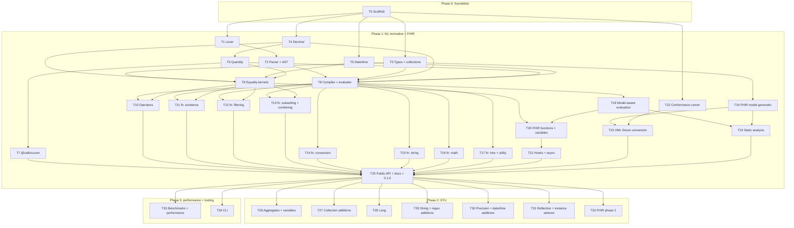

# Callis roadmap

> Status: **draft for review**. This roadmap breaks the work described in [architecture.md](architecture.md) into tasks sized for one worker and one pull request each.
> Task IDs (`T0`, `T1`, …) are stable. Refer to them in branch names, PR titles and commit messages.

## How to use this roadmap

- **One task = one PR.** If a task turns out too big, split it in the PR that starts it (for example `T8a`/`T8b`) and update this file.
- **A PR is done when** all of these hold:
  - the acceptance criteria are met
  - `pnpm check` is green
  - new behaviour has tests that cite the spec section they cover
  - publishable packages have a changeset
- **Spec interpretations** that are not obvious from the text go into `docs/spec-notes.md` (spec link + test names), in the same PR.
- **Changing an architectural decision** means updating the relevant section or ADR in `architecture.md` in the same PR.
- **Conformance groups** listed for a task are the groups from the HL7 test suite (`tests-fhir-r5.xml`) that the task should turn green. Until the conformance runner and converted fixtures exist (T22, T23), they are informational. After that, the PR shows the conformance delta, and the baseline may only go up.
- **Sizes** are rough, for one worker: **S** ≈ 1 day, **M** ≈ 2–4 days, **L** ≈ 1–2 weeks.

## Overview

| ID | Task | Phase | Depends on | Wave | Size |
| --- | --- | --- | --- | :---: | :---: |
| [T0](#t0--repository-scaffold) | Repository scaffold | 0 | – | 0 | M |
| [T1](#t1--lexer) | Lexer | 1 | T0 | 1 | M |
| [T2](#t2--parser-and-ast) | Parser and AST | 1 | T1 | 2 | M |
| [T3](#t3--type-system-and-collection-foundations) | Type system and collection foundations | 1 | T0 | 1 | M |
| [T4](#t4--decimal) | Decimal | 1 | T0 | 1 | M |
| [T5](#t5--date-datetime-and-time-values) | Date, DateTime and Time values | 1 | T0 | 1 | L |
| [T6](#t6--quantity-and-minimal-unit-system) | Quantity and minimal unit system | 1 | T4 | 2 | M |
| [T7](#t7--callisucum-package) | `@callis/ucum` package | 1 | T6 | 3 | L |
| [T8](#t8--compiler-and-evaluator-core) | Compiler and evaluator core | 1 | T2, T3, T4, T5, T6 | 3 | L |
| [T9](#t9--equality-equivalence-and-ordering-kernels) | Equality, equivalence and ordering kernels | 1 | T3, T4, T5, T6 | 3 | M |
| [T10](#t10--operators) | Operators | 1 | T8, T9 | 4 | L |
| [T11](#t11--functions-existence) | Functions: existence | 1 | T8, T9 | 4 | S |
| [T12](#t12--functions-filtering-and-projection) | Functions: filtering and projection | 1 | T8, T9 | 4 | M |
| [T13](#t13--functions-subsetting-and-combining) | Functions: subsetting and combining | 1 | T8, T9 | 4 | S |
| [T14](#t14--functions-conversion) | Functions: conversion | 1 | T8 | 4 | M |
| [T15](#t15--functions-string-manipulation) | Functions: string manipulation | 1 | T8 | 4 | M |
| [T16](#t16--functions-math) | Functions: math | 1 | T8 | 4 | S |
| [T17](#t17--functions-tree-navigation-and-utility) | Functions: tree navigation and utility | 1 | T8 | 4 | S |
| [T18](#t18--model-aware-evaluation) | Model-aware evaluation | 1 | T8 | 4 | L |
| [T19](#t19--fhir-model-generator-and-model-packages) | FHIR model generator and model packages | 1 | T3 | 2 | L |
| [T20](#t20--fhir-functions-and-variables) | FHIR functions and variables | 1 | T9, T18 | 5 | M |
| [T21](#t21--host-hooks-and-async-evaluation) | Host hooks and async evaluation | 1 | T20 | 6 | M |
| [T22](#t22--conformance-runner) | Conformance runner | 1 | T0 | 1 | M |
| [T23](#t23--fhir-xml-fixture-conversion) | FHIR XML fixture conversion | 1 | T19, T22 | 3 | M |
| [T24](#t24--static-analysis-and-strict-mode) | Static analysis and strict mode | 1 | T18, T19 | 5 | L |
| [T25](#t25--public-api-documentation-and-release-010) | Public API, documentation and release 0.1.0 | 1 | phase 1 | 7 | M |
| [T26](#t26--stu-aggregates-and-variables) | STU: aggregates and variables | 2 | T25 | 8 | M |
| [T27](#t27--stu-collection-additions) | STU: collection additions | 2 | T25 | 8 | M |
| [T28](#t28--stu-long-type) | STU: `Long` type | 2 | T25 | 8 | M |
| [T29](#t29--stu-string-and-regex-additions) | STU: string and regex additions | 2 | T25 | 8 | M |
| [T30](#t30--stu-precision-boundaries-and-datetime-additions) | STU: precision, boundaries and date/time additions | 2 | T25 | 8 | L |
| [T31](#t31--stu-reflection-and-instance-selector) | STU: reflection and instance selector | 2 | T25 | 8 | M |
| [T32](#t32--fhir-phase-2-structure-functions-and-r5-service-apis) | FHIR phase 2: structure functions and R5 service APIs | 2 | T25 | 8 | L |
| [T33](#t33--benchmarks-and-performance) | Benchmarks and performance | 3 | T25 | 8 | L |
| [T34](#t34--cli-optional) | CLI (optional) | 3 | T25 | 8 | M |

## Dependency graph

## Waves (suggested order)

Tasks in the same wave can be worked on in parallel. A task can start as soon as its own dependencies are merged; it does not have to wait for its whole wave.

| Wave | Tasks | Parallel workers | Notes |
| :---: | --- | :---: | --- |
| 0 | T0 | 1 | Everything else waits for the scaffold. |
| 1 | T1, T3, T4, T5, T22 | 5 | Independent leaf modules, plus fixture vendoring. |
| 2 | T2, T6, T19 | 3 | |
| 3 | T7, T8, T9, T23 | 4 | T8 is on the critical path; staff it first. |
| 4 | T10, T11, T12, T13, T14, T15, T16, T17, T18 | up to 9 | Function groups only add files in `src/functions/`, so they rarely conflict. |
| 5 | T20, T24 | 2 | |
| 6 | T21 | 1 | |
| 7 | T25 | 1 | Phase 1 complete → release 0.1.0. |
| 8 | T26–T34 | up to 9 | STU features, FHIR phase 2, performance and CLI, all independent. |

**Critical path:** T0 → T1 → T2 → T8 → T18 → T20 → T21 → T25. Delays on these tasks delay the 0.1.0 release. Everything else has slack.

**Conformance becomes measurable** once T8, T22 and T23 are merged (end of wave 3). From wave 4 on, every PR reports its conformance delta.

---

## Phase 0: foundation

### T0 — Repository scaffold

**Goal:** a working pnpm monorepo where every later task can add code and tests without touching the tooling.

**Scope**

- **Root workspace:**
  - `package.json`: private, `packageManager` pinned to the current pnpm major, `engines.node >= 22`
  - scripts: `build`, `test`, `test:watch`, `typecheck`, `lint`, `format`, `check` (lint + typecheck + test + build + package checks) and `changeset`
  - `pnpm-workspace.yaml` (`packages/*`, `tools/*`), `.node-version` (24), `.editorconfig`, `.gitignore`
  - a `LICENSE` file (MIT); the README says MIT, but the file is missing
- **TypeScript 7:** `tsconfig.base.json` with the flags from [architecture §17](architecture.md#17-build-packaging-and-runtime-targets) (`strict`, `exactOptionalPropertyTypes`, `noUncheckedIndexedAccess`, `verbatimModuleSyntax`, `isolatedDeclarations`), per-package `tsconfig.json`, `typecheck` with `tsc --noEmit`.
- **Build:** [tsdown](https://tsdown.dev) in `packages/core`, producing ESM `dist/index.js` and `dist/index.d.ts`. Pin the tsdown version (it is still 0.x).
- **Tests:** Vitest with `projects` (one per package), a smoke test in core, and coverage (`@vitest/coverage-v8`) configured but not enforced.
- **Lint/format:** [Biome](https://biomejs.dev) with `biome.json`. `biome ci` runs in CI.
- **Package checks:**
  - `publint`
  - `@arethetypeswrong/cli`
  - a script that fails if `@callis/core` has any `dependencies`
  - a script that reports the gzip size of `@callis/core`
- **Versioning:** Changesets (`.changeset/config.json`, independent versions, `access: public`).
- **CI:** `.github/workflows/ci.yml` runs on push and pull request:
  - `pnpm install --frozen-lockfile`
  - `biome ci`
  - typecheck
  - tests on Node 22, 24 and 26
  - build
  - package checks

  Concurrent runs on the same ref are cancelled.
- **`packages/core`** (`@callis/core`):
  - `package.json` with `version: 0.0.0`, `type: module`, an `exports` map, `files`, `sideEffects: false`, `engines`, `license`, `repository` and `keywords`
  - `src/index.ts` with an **empty public API**
  - an internal `src/errors/` skeleton: the `FhirPathError` hierarchy, `SourceSpan`, the `ErrorCode` union and `format()` from [architecture §15](architecture.md#15-errors-and-diagnostics). Every wave-1 task needs this module, so it is created here to avoid merge conflicts.
- **`CONTRIBUTING.md`:** commands, branch and PR conventions (task IDs, Conventional Commits), how to add a changeset, and links to the docs.

**Out of scope:** any FHIRPath functionality; the release workflow (T25).

**Acceptance criteria**

- [ ] On a clean clone, `pnpm install && pnpm check` passes on Node 22, 24 and 26.
- [ ] CI runs on every PR and is green. Breaking lint, types or tests turns it red (checked once, by hand).
- [ ] `pnpm --filter @callis/core build` emits ESM + `.d.ts`. publint and attw report no problems.
- [ ] Adding a dependency to `@callis/core` makes the no-dependency check fail (checked once, by hand).
- [ ] `pnpm changeset` works.
- [ ] The README links to `docs/` and `CONTRIBUTING.md`.

**Depends on:** – · **Parallel with:** – · **Size:** M

---

## Phase 1: N1 normative + FHIR additions

### T1 — Lexer

**Goal:** turn an expression string into tokens with exact source spans, as described in [architecture §4](architecture.md#4-lexer).

**Scope**

- `src/lexer/`: token kinds, the lexer, character-code constants, and a line table for line/column lookup.
- Identifiers, delimited identifiers, strings with all escapes, numbers (including the `1.toString()` rule), date/time literals (`@2015`, `@2015-02-04T14:34:28+09:00`, `@2015T`, `@T14:30:14.559`), symbols and operators, `$this`/`$index`/`$total`, and `%` followed by an identifier, a delimited identifier or a string. The double-quoted `%"…"` form is accepted for compatibility.
- Comments and whitespace, plus an `includeTrivia` option.
- Error codes `syntax/unterminated-string`, `syntax/invalid-escape`, `syntax/unexpected-character` and `syntax/invalid-date-literal` (shape only).

**Acceptance criteria**

- [ ] Every token kind is produced with correct `start`/`end`. Errors report correct line and column.
- [ ] All examples in [N1 §8](https://hl7.org/fhirpath/N1/#lexical-elements) and all escapes in [N1 §4.1.2](https://hl7.org/fhirpath/N1/#string) have table-driven tests.
- [ ] Edge cases are covered: `1.toString()`, `1.5`, `` `div` ``, unterminated `/*`, `@2015-01-01T`, `@T14`, timezone `Z` and `±hh:mm`.
- [ ] A fuzz test (random strings) never crashes; it only produces tokens or `FhirPathSyntaxError`.
- [ ] Line coverage of `lexer/` is at least 95%.

**Depends on:** T0 · **Parallel with:** T3, T4, T5, T22 · **Size:** M · **Conformance groups:** `comments` (with T2)

### T2 — Parser and AST

**Goal:** a Pratt/recursive-descent parser that produces the AST from [architecture §5](architecture.md#5-parser-and-ast).

**Scope**

- `src/parser/ast.ts`: node types with spans, where literals keep their raw text.
- `src/parser/precedence.ts` and `parser.ts`:
  - the binding-power table
  - postfix `.` and `[]`
  - prefix `+` and `-`
  - `is`/`as` with greedy type specifiers
  - function calls and argument lists
  - quantity literals (number + string, or number + calendar keyword)
  - `{}`
  - keyword-identifiers (`as`, `contains`, `in`, `is`)
  - a nesting-depth limit
- An internal `parse()` and a test-only AST printer (S-expressions) for compact structural assertions.
- Syntax errors that name the expected token.

**Acceptance criteria**

- [ ] Each adjacent pair of precedence levels has a test, as does left-associativity and the N1 §6.8 example `-7.combine(3)`. `x as Quantity.unit` parses as a type specifier.
- [ ] Every `<expression>` in `tests-fhir-r4.xml` and `tests-fhir-r5.xml` without `invalid="syntax"` parses, and every `invalid="syntax"` one throws `FhirPathSyntaxError`. Exception: expressions that use phase-2 syntax (`L` literals, instance selectors), which are listed in the PR. The XML files come from T22's vendored fixtures; if T22 has not landed yet, copy the two files into the test folder temporarily.
- [ ] No imports from `values/`; literal conversion is the compiler's job (T8).
- [ ] Line coverage of `parser/` is at least 95%.

**Depends on:** T1 · **Parallel with:** T6, T19 · **Size:** M · **Conformance groups:** `comments`, `testPrecedence` (parse level)

### T3 — Type system and collection foundations

**Goal:** the shared, dependency-free building blocks used by the runtime, functions and model support ([architecture §8](architecture.md#8-values-and-types), [§12.2](architecture.md#122-modelprovider-interface-sketch)).

**Scope**

- `src/types/`:
  - System type names and `TypeSpecifier`
  - type-specifier resolution (model namespace first, then System)
  - the implicit-conversion table as data
  - `is`/`as` subtype checks against System types plus a `ModelProvider` hook
- `src/model/model-provider.ts`: the `ModelProvider`, `ModelTypeInfo` and `ElementInfo` interfaces. This is a contract used by T18 and T19, so review it carefully.
- `src/model/model-node.ts`: the `ModelNode` data class (structure only; navigation comes in T8/T18).
- `src/runtime/collection.ts`: the `Collection` type, the frozen `EMPTY`, and builder helpers.
- `src/runtime/logic.ts`: three-valued truth tables for `and`, `or`, `xor`, `implies` and `not`.
- `src/runtime/singleton.ts`: the four-step singleton evaluation from [N1 §4.5](https://hl7.org/fhirpath/N1/#singleton-evaluation-of-collections), with a conversion callback so it does not depend on value classes.
- `src/values/string.ts`: string equivalence normalization, plus equality, equivalence and comparison kernels for String, Integer and Boolean.

**Acceptance criteria**

- [ ] The three-valued logic tables are tested exhaustively against [N1 §6.5](https://hl7.org/fhirpath/N1/#boolean-logic).
- [ ] All four branches of singleton evaluation are tested, including the `eval/singleton-expected` error.
- [ ] Type-specifier resolution is tested with a stub model: the model is searched before System, and qualified names resolve directly.
- [ ] String equivalence follows [N1 string equivalence](https://hl7.org/fhirpath/N1/#string-equivalence) (case, whitespace).
- [ ] The interfaces are documented with TSDoc.

**Depends on:** T0 · **Parallel with:** T1, T4, T5, T22 · **Size:** M

### T4 — Decimal

**Goal:** an exact, precision-preserving `Decimal` without dependencies ([architecture §9](architecture.md#9-decimal), [ADR-005](architecture.md#adr-005-own-bigint-based-decimal)).

**Scope**

- `src/values/decimal/`:
  - parse from literal or string text, and from `number` (shortest round-trip)
  - `toString()` that keeps the scale
  - `add`, `subtract`, `multiply`, `divide` (28 significant digits, at least 8 fractional digits, trailing zeros removed, empty on division by zero)
  - `div`, `mod`, `negate`, `abs`, `round(precision)` (half away from zero), `truncate`, `floor`, `ceiling`
  - `compare`, `equals` (trailing zeros ignored), `equivalent` (rounded to the less precise operand)
  - conversion to and from Integer
  - `sqrt`, `exp`, `ln`, `log`, `power` (integer exponents exact; others through `number`, rounded to 15 significant digits)
- Property-based tests (`fast-check`) against `decimal.js`, which is a dev dependency only.

**Acceptance criteria**

- [ ] `1.0.toString() = '1.0'`, `0.1 + 0.2 = 0.3`, `1.2 * 1.8 = 2.16`, `(1.2 / 1.8).round(2) = 0.67`, `1 / 2 = 0.5`, and `-0.5.round() = -1` (3.0.0).
- [ ] Property tests pass for add, subtract, multiply, divide and compare against the oracle (at least 1,000 runs each).
- [ ] No runtime dependency. Line coverage of `decimal/` is at least 95%.

**Depends on:** T0 · **Parallel with:** T1, T3, T5, T22 · **Size:** M

### T5 — Date, DateTime and Time values

**Goal:** partial-precision date/time values with spec-compliant comparison and arithmetic ([architecture §10](architecture.md#10-date-datetime-and-time), [ADR-006](architecture.md#adr-006-own-datetime-value-types)).

**Scope**

- `src/values/datetime/`:
  - `DateValue`, `DateTimeValue` and `TimeValue`
  - parsing of FHIRPath literals and FHIR JSON strings (`date`, `dateTime`, `instant`, `time`), with validation
  - FHIRPath `toString()` and FHIR JSON formatting
- Comparison, equality and equivalence kernels:
  - precision-by-precision comparison, with seconds and milliseconds as one decimal precision
  - timezone normalization
  - a default-offset parameter for values without an offset
- Arithmetic with calendar units (`addCalendar(value, amount, unit)`), independent of the `Quantity` class:
  - month-end clamping
  - truncation of partial values
  - allowed units per type
  - an error for definite durations above seconds; the caller passes the unit kind
- Helpers for taking the `now` snapshot.

**Acceptance criteria**

- [ ] All examples in [N1 §4.1.5–4.1.7](https://hl7.org/fhirpath/N1/#date), [Date/Time equality](https://hl7.org/fhirpath/N1/#datetime-equality), [§6.2](https://hl7.org/fhirpath/N1/#comparison) and [§6.7](https://hl7.org/fhirpath/N1/#datetime-arithmetic) have tests.
- [ ] Leap years, month ends (`@2020-01-31 + 1 month = @2020-02-29`), negative amounts, offsets of ±14:00, and `Z` are covered.
- [ ] Property tests cover antisymmetry and transitivity of comparison, and `a = b` ⇒ `a ~ b` when both have the same precision.
- [ ] No dependency on `Date`'s local timezone, except through the explicit default-offset parameter.

**Depends on:** T0 · **Parallel with:** T1, T3, T4, T22 · **Size:** L · **Conformance groups:** `period` (with T18)

### T6 — Quantity and minimal unit system

**Goal:** the `Quantity` value and the minimal built-in `UnitSystem` that core ships with ([architecture §11](architecture.md#11-quantity-and-ucum), [ADR-007](architecture.md#adr-007-ucum-minimal-unit-system-in-core-full-ucum-in-callisucum)).

**Scope**

- `src/values/quantity/`:
  - `Quantity { value: Decimal; unit }`, with calendar keywords normalized to singular
  - `toString()` (`1 'wk'`, `1 week`)
  - the `UnitSystem` interface
- The minimal implementation:
  - identical units
  - the UCUM time units `ms`, `s`, `min`, `h`, `d`, `wk`, `mo`, `a`
  - the calendar ↔ definite duration table ([N1 §4.1.8](https://hl7.org/fhirpath/N1/#time-valued-quantities))
- Quantity equality, equivalence and comparison kernels, and `+ - * /` kernels, all through the `UnitSystem`.
- A helper that maps FHIR `Quantity` JSON to `System.Quantity` ([R5 §2.1.9.1.3](https://hl7.org/fhir/R5/fhirpath.html#quantity)).

**Acceptance criteria**

- [ ] `1 year = 1 'a'` is `false`, `1 year ~ 1 'a'` is `true`, `1 second = 1 's'` is `true`, `10 seconds > 1 's'` is `true`, and `1 year > 1 'a'` is empty.
- [ ] With the minimal unit system, units it does not know compare as empty, and no error is thrown.
- [ ] The `UnitSystem` interface is documented and has a test double for other tasks to use.

**Depends on:** T4 · **Parallel with:** T2, T19 · **Size:** M · **Conformance groups:** `testQuantity` (time units, with T10)

### T7 — `@callis/ucum` package

**Goal:** full UCUM unit conversion as an opt-in package with no runtime dependencies.

**Scope**

- `packages/ucum` (`@callis/ucum`), exporting a `UnitSystem` implementation named `ucum`.
- A generator script (`packages/ucum/scripts/`) that reads a pinned `ucum-essence.xml` and emits TypeScript tables: prefixes, base units, and derived units with exact `Decimal` factors and dimension vectors. The output is committed.
- A UCUM expression parser covering prefixes, atoms, exponents, `.` and `/`, `{annotations}` (ignored for conversion), `10*n` and `10^n`.
- Conversion and dimension analysis, canonical `multiply`/`divide`, and the special units `Cel` and `[degF]`. Other special units are reported as not convertible.
- A license notice for the UCUM data, as decided by the owner (see the open questions in architecture.md).

**Acceptance criteria**

- [ ] `1 'kg' = 1000 'g'`, `1 'cm' < 1 'm'`, `12 'cm2' / 3 'cm' = 4.0 'cm'`, `1 'mg/dL'` converts to `'g/L'`, and `100 'Cel' > 50 '[degF]'`.
- [ ] Unknown or invalid units return `undefined` instead of throwing.
- [ ] No runtime dependency; the gzip size is reported in the PR.
- [ ] The conformance groups `testQuantity` and `testQuantityUnitComparison` pass once T10 is merged.

**Depends on:** T6 · **Parallel with:** T8, T9, T23 · **Size:** L

### T8 — Compiler and evaluator core

**Goal:** compile an AST into closures and evaluate them over plain JSON ([architecture §7](architecture.md#7-evaluator-compiling-to-closures), [ADR-003](architecture.md#adr-003-compile-the-ast-to-closures), [ADR-004](architecture.md#adr-004-synchronous-core-with-a-maybepromise-async-path)).

**Scope**

- `src/compiler/`:
  - `compileNode()` for every AST kind
  - literal construction through the T4/T5/T6 value modules, with range validation of date literals
  - constant folding of `-<number>`
  - `MaybePromise` helpers (`then`, `all`, the sync guard)
  - lambda compilation for higher-order parameters
- `src/runtime/`:
  - `EvalContext` and `Frame` (`$this`, `$index`)
  - model-less JSON navigation: array flattening, own-property checks, `ModelNode` creation
  - the root-identifier rule against `resourceType`
  - variables: `%context`, `%ucum`, user variables, and the `eval/undefined-variable` error
- In the compiler, the operators that do not need equality: the indexer `[]`, unary `+`/`-`, `and`/`or`/`xor`/`implies` (three-valued logic, both operands evaluated), and `is`/`as` on System types.
- `src/functions/registry.ts` and `define.ts`:
  - `FunctionDefinition`, `ParamSpec`, `createRegistry()`
  - compile-time lookup with `semantic/unknown-function` and `semantic/wrong-arity`
  - helpers for value, lambda and host functions
  - a handful of test-only functions to exercise the machinery
- `src/api/`: internal `compile()` and `evaluate()`, plus basic `plain`/`typed` output adapters (finished in T25).

**Out of scope:** equality-based operators (T10), model-aware navigation (T18), real library functions (T11–T17).

**Acceptance criteria**

- [ ] End to end: `compile(expr).evaluate(json)` works for navigation, literals of every type, the indexer, `$this`, `$index`, variables, Boolean logic, and `is`/`as` with System types.
- [ ] Each lambda helper is tested in sync mode, and in async mode using a test-only async function. A thenable in sync mode raises `eval/async-in-sync`.
- [ ] Navigating to `__proto__`, `constructor` or `toString` returns empty.
- [ ] A compiled expression can be evaluated concurrently (two overlapping async evaluations) without interference.
- [ ] Conformance groups `testDollar`, `testIndexer`, `testCollectionBoolean` and the literal parts of `testLiterals` pass once fixtures exist (T23).

**Depends on:** T2, T3, T4, T5, T6 · **Parallel with:** T7, T9, T23 · **Size:** L

### T9 — Equality, equivalence and ordering kernels

**Goal:** item-level and collection-level `equals`, `equivalent` and `compare` for every value kind ([architecture §8.6–8.7](architecture.md#86-equality-and-equivalence)). The operators and collection functions build on these.

**Scope**

- `src/runtime/equality.ts`:
  - dispatch over item kinds, including implicit conversions (Integer → Decimal, Date → DateTime) and `ModelNode` → System value conversion
  - recursive equality of complex values (JSON objects in model-less mode)
  - an extension point for model-specific equivalence, which T20 uses for `Coding`/`CodeableConcept`
  - collection-level `=` (order-sensitive) and `~` (order-insensitive)
  - the return type is `true | false | undefined`
- `src/runtime/comparison.ts`: `compare(a, b): -1 | 0 | 1 | undefined`, and `eval/type-mismatch` for incompatible types.

**Acceptance criteria**

- [ ] Every row of the table in architecture §8.6 has tests, including the "undetermined" cases (dates with different precision, incomparable quantities).
- [ ] Integer and Decimal mix correctly (`1 = 1.0`, `1 ~ 1.0`), and so do Date and DateTime.
- [ ] Equality of complex JSON objects is recursive and order-sensitive for arrays.

**Depends on:** T3, T4, T5, T6 · **Parallel with:** T7, T8, T23 · **Size:** M

### T10 — Operators

**Goal:** all remaining N1 operators, with correct empty propagation, singleton rules and errors ([N1 §6](https://hl7.org/fhirpath/N1/#operations)).

**Scope**

- `=`, `~`, `!=` and `!~` (on top of T9).
- `<`, `>`, `<=` and `>=`.
- `+` for numbers, strings, quantities and date/time; `-`, `*`, `/`, `div` and `mod`; `&`.
- `|` (union with deduplication), `in` and `contains`.
- Integer overflow behaviour and division by zero (empty).
- Date/time + quantity arithmetic, wired to T5/T6.
- Singleton checks with `eval/singleton-expected`.

**Acceptance criteria**

- [ ] Every example in N1 §6.1–6.7 has a table-driven test.
- [ ] Empty propagation is tested for every operator, including `&` (empty = `''`) and `{} ~ {}` (`true`).
- [ ] Conformance groups: `testEquality`, `testNEquality`, `testEquivalent`, `testNotEquivalent`, `testLessThan`, `testLessOrEqual`, `testGreatorOrEqual`, `testGreaterThan`, `testIn`, `testContainsCollection`, `testBooleanLogicAnd`, `testBooleanLogicOr`, `testBooleanLogicXOr`, `testBooleanImplies`, `testPlus`, `testConcatenate`, `testMinus`, `testMultiply`, `testDivide`, `testDiv`, `testMod`, `testPrecedence` and `testQuantity`. Any failures that remain are explained in the PR.

**Depends on:** T8, T9 · **Parallel with:** T11–T18 · **Size:** L

### T11 — Functions: existence

**Goal:** [N1 §5.1](https://hl7.org/fhirpath/N1/#existence): `empty`, `exists([criteria])`, `all`, `allTrue`, `anyTrue`, `allFalse`, `anyFalse`, `subsetOf`, `supersetOf`, `count`, `distinct`, `isDistinct`.

**Acceptance criteria**

- [ ] The spec examples for each function are tests in `existence.test.ts`.
- [ ] Undetermined equality (for example dates with different precision) follows the test suite (`isDistinct()` / `distinct()` return empty).
- [ ] Conformance groups: `testExists`, `testAll`, `testSubSetOf`, `testSuperSetOf`, `testCount`, `testDistinct`.

**Depends on:** T8, T9 · **Parallel with:** T10, T12–T18 · **Size:** S

### T12 — Functions: filtering and projection

**Goal:** [N1 §5.2](https://hl7.org/fhirpath/N1/#filtering-and-projection): `where`, `select`, `repeat`, `ofType`.

**Scope:** lambda functions built on the T8 helpers. `repeat` deduplicates and is guaranteed to terminate. `ofType` works with System types now and with model types through the type-test API once T18 is merged.

**Acceptance criteria**

- [ ] Each function is tested in sync and async mode, and `$this`/`$index` are correct in nested lambdas.
- [ ] `repeat` terminates on self-referencing structures (for example `Questionnaire.repeat(item)`).
- [ ] Conformance groups: `testWhere`, `testSelect`, `testRepeat`.

**Depends on:** T8, T9 · **Parallel with:** T10, T11, T13–T18 · **Size:** M

### T13 — Functions: subsetting and combining

**Goal:** [N1 §5.3–5.4](https://hl7.org/fhirpath/N1/#subsetting): `single`, `first`, `last`, `tail`, `skip`, `take`, `intersect`, `exclude`, `union`, `combine`. The indexer was done in T8.

**Acceptance criteria**

- [ ] The spec examples are tests. `single()` on more than one item raises `eval/singleton-expected`.
- [ ] Conformance groups: `testSingle`, `testFirstLast`, `testTail`, `testSkip`, `testTake`, `testIntersect`, `testExclude`, `testUnion`, `testCombine()` (except the STU `preserveOrder` cases).

**Depends on:** T8, T9 · **Parallel with:** T10–T12, T14–T18 · **Size:** S

### T14 — Functions: conversion

**Goal:** [N1 §5.5](https://hl7.org/fhirpath/N1/#conversion):

- `iif` (lazy: only the selected branch is evaluated)
- `toBoolean` and `convertsToBoolean`
- `toInteger` and `convertsToInteger`
- `toDecimal` and `convertsToDecimal`
- `toDate` and `convertsToDate`
- `toDateTime` and `convertsToDateTime`
- `toTime` and `convertsToTime`
- `toString` and `convertsToString`
- `toQuantity([unit])` and `convertsToQuantity([unit])`

**Acceptance criteria**

- [ ] Each conversion table in N1 §5.5 is fully covered, including the string formats it accepts and rejects.
- [ ] `toString()` formats are tested: `1.0 → '1.0'`, `1 'wk'`, `1 week`, dates without `@`.
- [ ] Conformance groups: `testIif`, `testToInteger`, `testToDecimal`, `testToString`, and the conversion parts of `testLiterals` and `testTypes`.

**Depends on:** T8 · **Parallel with:** T10–T13, T15–T18 · **Size:** M

### T15 — Functions: string manipulation

**Goal:** [N1 §5.6](https://hl7.org/fhirpath/N1/#string-manipulation): `indexOf`, `substring`, `startsWith`, `endsWith`, `contains`, `upper`, `lower`, `replace`, `matches`, `replaceMatches`, `length`, `toChars`.

**Scope:**

- Decide whether "characters" means Unicode code points or UTF-16 units. The 3.0.0 examples count a surrogate pair as one character; record the choice in `spec-notes.md`.
- Regular expressions use JavaScript `RegExp` with the `u` flag. Record dialect notes.

**Acceptance criteria**

- [ ] The spec examples are tests, including empty and edge cases (`substring` out of range, `''.length()`).
- [ ] Conformance groups: `testCase`, `testToChars`, `testIndexOf`, `testSubstring`, `testStartsWith`, `testEndsWith`, `testContainsString`, `testMatches`, `testReplaceMatches`, `testReplace`, `testLength` (except STU cases with regex flags).

**Depends on:** T8 · **Parallel with:** T10–T14, T16–T18 · **Size:** M

### T16 — Functions: math

**Goal:** [N1 §5.7](https://hl7.org/fhirpath/N1/#math) (STU in N1, but in phase-1 scope): `abs`, `ceiling`, `exp`, `floor`, `ln`, `log`, `power`, `round`, `sqrt`, `truncate`, using the T4 kernels. `abs` also supports Quantity.

**Acceptance criteria**

- [ ] The spec examples are tests. Invalid results (`(-1).sqrt()`, `(-1).power(0.5)`) are empty.
- [ ] Conformance groups: `testRound`, `testSqrt`, `testAbs`, `testCeiling`, `testExp`, `testFloor`, `testLn`, `testLog`, `testPower`, `testTruncate`.

**Depends on:** T8 · **Parallel with:** T10–T15, T17, T18 · **Size:** S

### T17 — Functions: tree navigation and utility

**Goal:** [N1 §5.8–5.9](https://hl7.org/fhirpath/N1/#tree-navigation): `children`, `descendants`, `trace(name[, projection])`, `now`, `timeOfDay`, `today`.

**Scope:**

- `children` and `descendants` work model-less here; model-aware ordering arrives with T18.
- `trace` sends events to the `trace` hook (a no-op by default).
- `now`, `today` and `timeOfDay` read the per-evaluation snapshot and honour the `now` and `timezoneOffset` options.

**Acceptance criteria**

- [ ] `now()` returns the same value when called twice within one evaluation, and the injected `now` is respected.
- [ ] `_field` keys never appear as children. `descendants()` terminates and keeps document order.
- [ ] Conformance groups: `testTrace`, `testToday`, `testNow`.

**Depends on:** T8 · **Parallel with:** T10–T16, T18 · **Size:** S

### T18 — Model-aware evaluation

**Goal:** use a `ModelProvider` during evaluation ([architecture §12](architecture.md#12-model-abstraction)).

**Scope**

- Typed navigation:
  - `ModelNode.type` set from the model
  - choice elements (`value` → `valueQuantity`, etc.)
  - `lenient.choiceSuffix`
  - primitive extensions (`_field`, index-aligned arrays)
  - extension-only primitives
- Converting FHIR primitives to System values (memoized), with `FHIR.date` → `System.Date`.
- The root identifier as a type, with inheritance (`DomainResource.contained…`).
- `is`, `as` and `ofType` with model types, following the FHIR rules for primitives.
- Model-ordered `children()` and `descendants()`.
- `parseJson()`: a lossless JSON parser (`JsonNumber`), which navigation understands.
- A hand-written mini FHIR model fixture (Patient, Observation, HumanName, Quantity, Extension and the primitives) so that this task does not wait for T19.

**Acceptance criteria**

- [ ] `Observation.value.ofType(Quantity).unit` works. `Observation.valueQuantity` is empty or a semantic error by default, and works with `lenient.choiceSuffix`.
- [ ] `Patient.name.given` on `["a", null]` with `_given: [null, {extension}]` gives two nodes, and the second has `hasValue()` false (checked once T20 is merged).
- [ ] With `parseJson`, `1.50` keeps its precision end to end (`toString()` returns `'1.50'`).
- [ ] With the real R4 model (once T19 is merged), conformance groups `testBasics`, `testObservations`, `polymorphics`, `testInheritance`, `testMiscellaneousAccessorTests` and the model parts of `testTypes` pass.

**Depends on:** T8 · **Parallel with:** T10–T17 · **Size:** L

### T19 — FHIR model generator and model packages

**Goal:** generate compact R4 and R5 models from the official StructureDefinitions and publish them as `ModelProvider`s ([architecture §12.6](architecture.md#126-generated-fhir-models-r4-r5), [ADR-008](architecture.md#adr-008-modelprovider-with-generated-fhir-models-in-separate-packages)).

**Scope**

- `tools/model-gen`:
  - downloads [`hl7.fhir.r4.core@4.0.1`](https://packages.fhir.org/hl7.fhir.r4.core/4.0.1) and [`hl7.fhir.r5.core@5.0.0`](https://packages.fhir.org/hl7.fhir.r5.core/5.0.0) from the FHIR package registry into a local cache that is not committed
  - reads the snapshots
  - emits a deterministic, compact TypeScript data module
- What the data module contains: types, base types, kinds, abstractness; elements with name, types, whether they repeat and whether they are choices; backbone types named by path; `contentReference` resolved; the primitive → System mapping.
- `packages/fhir-r4` (`@callis/fhir-r4`) and `packages/fhir-r5` (`@callis/fhir-r5`): `ModelProvider` implementations over the generated data, exported as `r4` and `r5`, with a peer dependency on `@callis/core`.
- A CI job (on changes to `tools/model-gen` or a manual trigger) that checks regeneration gives no diff.

**Acceptance criteria**

- [ ] All resources and data types from the core packages are present. Spot checks:
  - `Patient.deceased` is a choice of `boolean | dateTime`
  - `Questionnaire.item.item` resolves to `Questionnaire.item`
  - `Bundle.entry.resource` has type `Resource`
  - `Observation.value[x]` lists the correct types per version
- [ ] Running the generator twice gives byte-identical output.
- [ ] Gzip size per model is reported. Over 60 kB needs a justification in the PR.

**Depends on:** T3 · **Parallel with:** T2, T6 (and later waves) · **Size:** L

### T20 — FHIR functions and variables

**Goal:** the FHIR additions that need no host I/O ([architecture §13.1](architecture.md#131-variables), [R5 §2.1.9.1](https://hl7.org/fhir/R5/fhirpath.html#rules)).

**Scope**

- `src/fhir/`:
  - `extension(url)`, `hasValue()`, `getValue()`
  - `resolve()` for local references only: contained `#id` against `%rootResource`, and Bundle `fullUrl` / `type/id` matching
  - `%resource` and `%rootResource` (derived from the parent chain, with override options), `%sct`, `%loinc`, `` %`vs-*` ``, `` %`ext-*` ``
  - FHIR equivalence (`id` ignored; `Coding` on `system` + `code`; `CodeableConcept` on intersecting codings) through the T9 extension point
  - FHIR `Quantity` → `System.Quantity` in operations
- Registering `memberOf`, `subsumes`, `subsumedBy`, `conformsTo` and `htmlChecks` as host-backed functions that return empty without a hook. The hook plumbing is T21.

**Acceptance criteria**

- [ ] `Patient.birthDate.extension('http://…').value` works. `hasValue()` and `getValue()` behave correctly for extension-only primitives.
- [ ] `resolve()` finds contained resources and Bundle entries, and returns empty otherwise without an error.
- [ ] Conformance groups: `testExtension`, `testHasValue`, `testDollarResource`, `testVariables`, `primitivesWithoutValue`.

**Depends on:** T9, T18 · **Parallel with:** T24 · **Size:** M

### T21 — Host hooks and async evaluation

**Goal:** let hosts plug in I/O-backed behaviour, synchronously or asynchronously ([architecture §13.2–13.3](architecture.md#132-host-hooks), [ADR-004](architecture.md#adr-004-synchronous-core-with-a-maybepromise-async-path)).

**Scope**

- `EvaluationHooks` and `TerminologyProvider` types.
- `resolve` falls back to the hook.
- `memberOf`, `subsumes`, `subsumedBy`, `conformsTo` and `htmlChecks` are wired to their hooks.
- A `regex` hook for a safe regex engine.
- `evaluateAsync()` end to end: concurrent hook calls for the items of a collection, with a `concurrency` limit and output order preserved; `AbortSignal` with `eval/aborted`.

**Acceptance criteria**

- [ ] With an async `resolve` hook, `Bundle.entry.resource.subject.resolve().name` returns results in input order and respects `concurrency`.
- [ ] The same expression with a sync hook works through `evaluate()`. An async hook in `evaluate()` raises `eval/async-in-sync`.
- [ ] An aborted signal stops evaluation with `eval/aborted`.
- [ ] Conformance groups `testConformsTo`, `HTMLChecks`, and the `memberOf`/`subsumes` parts of `TerminologyTests` pass, using fake hooks in the runner.

**Depends on:** T20 · **Parallel with:** – · **Size:** M

### T22 — Conformance runner

**Goal:** run the official HL7 FHIRPath test suite and report the results ([architecture §19](architecture.md#19-testing-strategy), [ADR-011](architecture.md#adr-011-hl7-test-suite-as-the-conformance-arbiter)).

**Scope**

- `tools/conformance` (private):
  - vendored `tests-fhir-r5.xml` (from `r5/fhirpath/`) and `tests-fhir-r4.xml` (from `r4/fhirpath/`), plus every input file they reference, from [FHIR/fhir-test-cases](https://github.com/FHIR/fhir-test-cases) at a pinned commit
  - `SOURCE.md` with the commit SHA and the Apache-2.0 notice
  - an `update-fixtures` script
- A test-file parser (a dev-only XML parser such as `fast-xml-parser` is fine).
- Typed comparison of expected outputs (`boolean`, `integer`, `decimal`, `string`, `date`, `dateTime`, `time`, `code`, `id`, `Quantity`).
- Support for `invalid`, `predicate`, `ordered`, `context`/`contextType`, `mode` and `version`.
- Classification of each test as *phase 1*, *STU* or *unsupported*.
- A runner CLI and a Vitest project (`pnpm test:conformance`).
- Reports: Markdown to `docs/conformance/{r4,r5}.md`, a JSON summary, and a CI job summary. The CI job is non-blocking until T23.
- A baseline ratchet (`baseline.json`) and a CI check against it.

**Acceptance criteria**

- [ ] The runner works against the public `evaluate` API even when it is still a stub. Every test is either run or skipped with a reason; nothing crashes the runner.
- [ ] Tests with JSON inputs run. Tests with XML inputs are skipped with the reason "fixture not converted" until T23.
- [ ] The report shows pass/fail/skip per group and per phase, with links to the failing expressions.

**Depends on:** T0 · **Parallel with:** T1, T3, T4, T5 · **Size:** M

### T23 — FHIR XML fixture conversion

**Goal:** convert the suite's XML input files to FHIR JSON once, so that every test can run.

**Scope**

- A model-driven FHIR XML → JSON converter in `tools/conformance`, using `@callis/fhir-r4` and `@callis/fhir-r5`:
  - arrays according to cardinality
  - typed primitives, with decimals kept as lossless text
  - `id`/`extension` on primitives written as `_field`
  - `xhtml` → string
  - `resourceType`, contained resources and choice element names
- The converted JSON is committed next to the XML.
- A check against an official JSON example where one exists (for example `patient-example` from `hl7.fhir.r4.examples`), allowing only documented differences.
- The conformance CI job becomes blocking, with the baseline ratchet.

**Acceptance criteria**

- [ ] Every XML input referenced by the suite converts. Any input that is out of scope (such as `ccda.xml`) is listed.
- [ ] The comparison with official JSON examples shows no unexplained differences.
- [ ] After this task, the conformance report covers every phase-1 test, and the baseline is committed.

**Depends on:** T19, T22 · **Parallel with:** T7, T8, T9 · **Size:** M

### T24 — Static analysis and strict mode

**Goal:** semantic checks and type inference with a model ([architecture §6](architecture.md#6-static-analysis-optional)).

**Scope**

- `src/analysis/`: type and cardinality inference over the AST, using the model, the function return types (`returns` in `FunctionDefinition`) and the operator rules.
- Diagnostics:
  - `semantic/unknown-element`
  - `semantic/unknown-type`
  - a wrong root type
  - choice suffixes, with a hint
  - obvious operator type errors
- Strict mode ([N1 §11](https://hl7.org/fhirpath/N1/#type-safety-and-strict-evaluation)) for operations that are unsafe on singletons.
- A public `analyze()`. `compile()` throws `FhirPathSemanticError` with all diagnostics attached.

**Acceptance criteria**

- [ ] `name.given1` and `Encounter.name.given` on `inputType: 'Patient'` are semantic errors (tests `testSimpleFail`, `testSimpleWithWrongContext`), and so is `Observation.valueQuantity.unit` (`testPolymorphismB`).
- [ ] Conformance group `isSemanticChecks` passes, as do all `invalid="semantic"` tests in phase 1.
- [ ] Analysis without a model never produces false errors for valid expressions in the suite.

**Depends on:** T18, T19 · **Parallel with:** T20, T21 · **Size:** L

### T25 — Public API, documentation and release 0.1.0

**Goal:** a polished, documented public API and the first release of `@callis/core`, `@callis/ucum`, `@callis/fhir-r4` and `@callis/fhir-r5` ([architecture §16](architecture.md#16-public-api-sketch)).

**Scope**

- `src/api/`:
  - final `parse`, `analyze`, `compile`, `evaluate`, `evaluateAsync` with overloads for `output: 'typed'`
  - option validation
  - an LRU compile cache
  - complete `plain` and `typed` output adapters
- `src/index.ts`: exports only the public API and public types.
- Type tests (`expectTypeOf`) for the public API.
- **Documentation:**
  - README quick start
  - `docs/guide.md`: model-less use, R4/R5, units, async hooks, errors, output modes
  - generated API reference (TypeDoc) or a decision not to generate one
  - `spec-notes.md` completed, with the conformance report linked
- An `examples/` folder that runs in CI.
- A release workflow (changesets GitHub Action, npm provenance) and release 0.1.0 of the four packages.

**Acceptance criteria**

- [ ] Every phase-1 conformance test passes, or is listed with a reason in `spec-notes.md`.
- [ ] publint, attw, the zero-dependency check and the size budget all pass.
- [ ] The README and guide examples are executed in CI.
- [ ] The packages are published to npm with provenance, and installing them in a fresh Node and Vite project works.

**Depends on:** T7, T10–T17, T21, T23, T24 (phase 1 complete) · **Parallel with:** – · **Size:** M

---

## Phase 2: STU features

These tasks implement STU parts of N1 and the additions in [FHIRPath 3.0.0](https://hl7.org/fhirpath/STU3/). They are independent of each other and can all run in parallel after 0.1.0. Each must make the matching conformance tests (those classified *STU*) pass and update the scope table in architecture §2.

### T26 — STU: aggregates and variables

**Goal:** `$total`, `aggregate(aggregator[, init])` ([N1 §7](https://hl7.org/fhirpath/N1/#aggregates)), `sum`, `min`, `max`, `avg`, and `defineVariable(name[, value])` with 3.0.0 scoping rules.

**Acceptance criteria:** the spec examples are tests; using `$total` outside `aggregate` is a semantic error; conformance groups `testAggregate` and `defineVariable` pass.

**Size:** M

### T27 — STU: collection additions

**Goal:** `sort([keySelector [asc|desc], …])`, `coalesce(…)`, `repeatAll(projection)`, `combine(other, preserveOrder)` and `pathname([short])`.

**Acceptance criteria:** the spec examples are tests; `sort` is stable and reuses the T9 comparison kernel; conformance groups `testSort` and the STU parts of `testCombine()` pass.

**Size:** M

### T28 — STU: `Long` type

**Goal:**

- `System.Long` (`bigint`) and the `L` literal suffix in the lexer and parser
- `toLong` and `convertsToLong`
- arithmetic and comparison
- implicit conversions (`Integer → Long → Decimal`)
- mapping `FHIR.integer64` (R5) to `System.Long`

**Acceptance criteria:** the spec examples are tests; overflow behaviour is documented; Long tests in the suite pass.

**Size:** M

### T29 — STU: string and regex additions

**Goal:** `lastIndexOf`, `matchesFull`, regex `flags` on `matches` and `replaceMatches`, `encode`/`decode` (`base64`, `urlbase64`, `hex`), `escape`/`unescape` (`html`, `json`), `trim`, `split` and `join`, all without runtime dependencies.

**Acceptance criteria:** conformance groups `testEncodeDecode`, `testEscapeUnescape`, `testTrim`, `testSplit` and `testJoin` pass, as do the STU cases in `testMatches`.

**Size:** M

### T30 — STU: precision, boundaries and date/time additions

**Goal:**

- `lowBoundary`, `highBoundary` and `precision` for Decimal, Date, DateTime, Time and Quantity
- the component functions `yearOf` … `millisecondOf`, `timezoneOffsetOf`, `dateOf` and `timeOf`
- `duration` and `difference`
- `comparable`
- date/time subtraction
- the Quantity variants of `ceiling`, `floor`, `round` and `truncate`

**Acceptance criteria:** conformance groups `LowBoundary`, `HighBoundary`, `Precision` and `Comparable` pass; boundary semantics for timezones are documented in `spec-notes.md`.

**Size:** L

### T31 — STU: reflection and instance selector

**Goal:** `type()` returning `SimpleTypeInfo`, `ClassInfo` or `ListTypeInfo` ([N1 §10.2](https://hl7.org/fhirpath/N1/#reflection), simplified in 3.0.0), and the 3.0.0 instance-selector syntax (`Type { element: value, … }`) using the model to build instances.

**Acceptance criteria:** conformance group `testType` passes; the instance selector parses, is type-checked with a model, and evaluates.

**Size:** M

### T32 — FHIR phase 2: structure functions and R5 service APIs

**Goal:**

- `elementDefinition()`, `slice(structure, name)` and `checkModifiers(modifier)`. These need richer model metadata, delivered through a separate entry point of the model packages.
- The draft R5 APIs ([R5 §2.1.9.3–2.1.9.5](https://hl7.org/fhir/R5/fhirpath.html#txapi)), all hook-based:
  - `%terminologies` (`expand`, `lookup`, `validateVS`, `validateCS`, `subsumes`, `translate`) through an extended `TerminologyProvider`
  - `%server`
  - `%factory`

**Acceptance criteria:** the `%terminologies` cases of `TerminologyTests` pass with a fake provider; the default model packages do not grow in size; the APIs are marked experimental in the docs.

**Size:** L

---

## Phase 3: performance and tooling

### T33 — Benchmarks and performance

**Goal:** measure performance, compare it with other engines, and make targeted optimizations.

**Scope**

- **Benchmarks:** a Vitest bench suite with a corpus of every FHIRPath expression from the R4/R5 search parameters and invariants, evaluated against example resources and bundles.
- **Baseline numbers:** compile time, sync evaluation, async evaluation with no-op hooks, and memory use.
- **Comparison:** against `fhirpath.js` (dev dependency only).
- **Optimizations backed by profiles, for example:**
  - closures specialized for sync-only use
  - a fast path for `Decimal` when values fit in a `number`
  - caching of navigation and type lookups
  - avoiding intermediate arrays
- **Tracking:** a non-blocking CI job that tracks benchmark trends.

**Acceptance criteria:** the benchmark suite and its results are committed (`docs/performance.md`); each optimization PR shows a before/after comparison; there are no conformance regressions.

**Size:** L

### T34 — CLI (optional)

**Goal:** `@callis/cli` with:

- `callis eval '<expr>' file.json [--model r4|r5] [--typed] [--var name=value]`
- `callis parse '<expr>'` (prints the AST)
- `callis check '<expr>' --type Patient` (runs the analyzer)

**Acceptance criteria:** works through `npx`; output is JSON or human-readable; errors are formatted with a source excerpt; exit codes are documented.

**Size:** M

---

## Backlog (not scheduled)

- R4B and R6 models (mostly a generator run once T19 exists).
- Parser error recovery and a language-server or editor integration.
- FHIR XML as an input format (a separate package that reuses the T23 converter).
- A SQL-on-FHIR `ViewDefinition` runner built on Callis.
- A differential test harness against `fhirpath.js` and the HL7 Java engine.
- An optional "compiled sync-only" build mode, if T33 shows a significant gain.
