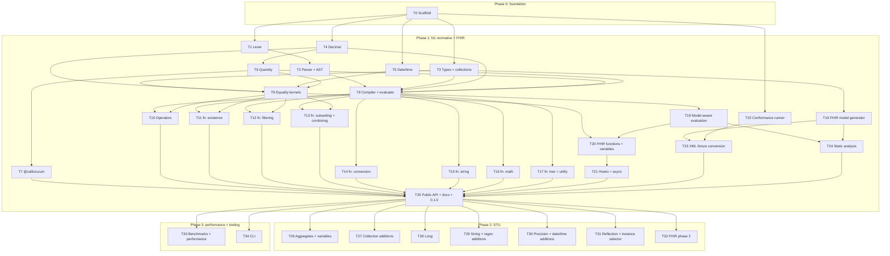

# Callis roadmap

> Status: **draft for review**. This is the index of the tasks that build Callis. Each task has its own file in [`tasks/`](tasks/) with goal, scope, design notes and acceptance criteria. The big picture is in [architecture.md](architecture.md); the reasons behind decisions are in [`adr/`](adr/README.md).
> Task IDs (`T0`, `T1`, …) are stable; file names are zero-padded (`T00-scaffold.md`) so they sort. Refer to the IDs in branch names, PR titles and commit messages.

## How to use this roadmap

- **One task = one PR.** A worker reads its task file and the ADRs it links. If a task turns out too big, split it in the PR that starts it (for example `T8a`/`T8b`) and update the task file and this index.
- **A PR is done when** all of these hold:
  - the acceptance criteria are met
  - `pnpm check` is green
  - new behaviour has tests that cite the spec section they cover
  - publishable packages have a changeset
- **Spec interpretations** that are not obvious from the text go into `docs/spec-notes.md` (spec link + test names), in the same PR.
- **Design details** live in the task file. If implementation changes them, update the task file in the same PR.
- **Changing an architectural decision** means updating (or superseding) its ADR in `docs/adr/` in the same PR.
- **Conformance groups** listed for a task are the groups from the HL7 test suite (`tests-fhir-r5.xml`) that the task should turn green. Until the conformance runner and converted fixtures exist (T22, T23), they are informational. After that, the PR shows the conformance delta, and the baseline may only go up.
- **Sizes** are rough, for one worker: **S** ≈ 1 day, **M** ≈ 2–4 days, **L** ≈ 1–2 weeks.

## Overview

| ID | Task | Phase | Depends on | Wave | Size |
| --- | --- | --- | --- | :---: | :---: |
| [T0](tasks/T00-scaffold.md) | Repository scaffold | 0 | – | 0 | M |
| [T1](tasks/T01-lexer.md) | Lexer | 1 | T0 | 1 | M |
| [T2](tasks/T02-parser.md) | Parser and AST | 1 | T1 | 2 | M |
| [T3](tasks/T03-types-and-collections.md) | Type system and collection foundations | 1 | T0 | 1 | M |
| [T4](tasks/T04-decimal.md) | Decimal | 1 | T0 | 1 | M |
| [T5](tasks/T05-date-time.md) | Date, DateTime and Time values | 1 | T0 | 1 | L |
| [T6](tasks/T06-quantity.md) | Quantity and minimal unit system | 1 | T4 | 2 | M |
| [T7](tasks/T07-ucum.md) | `@callis/ucum` package | 1 | T6 | 3 | L |
| [T8](tasks/T08-compiler-evaluator.md) | Compiler and evaluator core | 1 | T2, T3, T4, T5, T6 | 3 | L |
| [T9](tasks/T09-equality-kernels.md) | Equality, equivalence and ordering kernels | 1 | T3, T4, T5, T6 | 3 | M |
| [T10](tasks/T10-operators.md) | Operators | 1 | T8, T9 | 4 | L |
| [T11](tasks/T11-fn-existence.md) | Functions: existence | 1 | T8, T9 | 4 | S |
| [T12](tasks/T12-fn-filtering.md) | Functions: filtering and projection | 1 | T8, T9 | 4 | M |
| [T13](tasks/T13-fn-subsetting-combining.md) | Functions: subsetting and combining | 1 | T8, T9 | 4 | S |
| [T14](tasks/T14-fn-conversion.md) | Functions: conversion | 1 | T8 | 4 | M |
| [T15](tasks/T15-fn-string.md) | Functions: string manipulation | 1 | T8 | 4 | M |
| [T16](tasks/T16-fn-math.md) | Functions: math | 1 | T8 | 4 | S |
| [T17](tasks/T17-fn-tree-utility.md) | Functions: tree navigation and utility | 1 | T8 | 4 | S |
| [T18](tasks/T18-model-aware-evaluation.md) | Model-aware evaluation | 1 | T8 | 4 | L |
| [T19](tasks/T19-fhir-model-generator.md) | FHIR model generator and model packages | 1 | T3 | 2 | L |
| [T20](tasks/T20-fhir-functions.md) | FHIR functions and variables | 1 | T9, T18 | 5 | M |
| [T21](tasks/T21-hooks-async.md) | Host hooks and async evaluation | 1 | T20 | 6 | M |
| [T22](tasks/T22-conformance-runner.md) | Conformance runner | 1 | T0 | 1 | M |
| [T23](tasks/T23-xml-fixture-conversion.md) | FHIR XML fixture conversion | 1 | T19, T22 | 3 | M |
| [T24](tasks/T24-static-analysis.md) | Static analysis and strict mode | 1 | T18, T19 | 5 | L |
| [T25](tasks/T25-public-api-release.md) | Public API, documentation and release 0.1.0 | 1 | phase 1 | 7 | M |
| [T26](tasks/T26-stu-aggregates.md) | STU: aggregates and variables | 2 | T25 | 8 | M |
| [T27](tasks/T27-stu-collections.md) | STU: collection additions | 2 | T25 | 8 | M |
| [T28](tasks/T28-stu-long.md) | STU: `Long` type | 2 | T25 | 8 | M |
| [T29](tasks/T29-stu-strings.md) | STU: string and regex additions | 2 | T25 | 8 | M |
| [T30](tasks/T30-stu-precision-datetime.md) | STU: precision, boundaries and date/time additions | 2 | T25 | 8 | L |
| [T31](tasks/T31-stu-reflection.md) | STU: reflection and instance selector | 2 | T25 | 8 | M |
| [T32](tasks/T32-fhir-phase2.md) | FHIR phase 2: structure functions and R5 service APIs | 2 | T25 | 8 | L |
| [T33](tasks/T33-performance.md) | Benchmarks and performance | 3 | T25 | 8 | L |
| [T34](tasks/T34-cli.md) | CLI (optional) | 3 | T25 | 8 | M |

## Dependency graph

## Waves (suggested order)

Tasks in the same wave can be worked on in parallel. A task can start as soon as its own dependencies are merged; it does not have to wait for its whole wave.

| Wave | Tasks | Parallel workers | Notes |
| :---: | --- | :---: | --- |
| 0 | T0 | 1 | Everything else waits for the scaffold. |
| 1 | T1, T3, T4, T5, T22 | 5 | Independent leaf modules, plus fixture vendoring. |
| 2 | T2, T6, T19 | 3 | |
| 3 | T7, T8, T9, T23 | 4 | T8 is on the critical path; staff it first. |
| 4 | T10, T11, T12, T13, T14, T15, T16, T17, T18 | up to 9 | Function groups only add files in `src/functions/`, so they rarely conflict. |
| 5 | T20, T24 | 2 | |
| 6 | T21 | 1 | |
| 7 | T25 | 1 | Phase 1 complete → release 0.1.0. |
| 8 | T26–T34 | up to 9 | STU features, FHIR phase 2, performance and CLI, all independent. |

**Critical path:** T0 → T1 → T2 → T8 → T18 → T20 → T21 → T25. Delays on these tasks delay the 0.1.0 release. Everything else has slack.

**Conformance becomes measurable** once T8, T22 and T23 are merged (end of wave 3). From wave 4 on, every PR reports its conformance delta.

**Phase 2 (T26–T32)** implements the STU parts of N1 and the additions in [FHIRPath 3.0.0](https://hl7.org/fhirpath/STU3/). These tasks are independent of each other and can all run in parallel after 0.1.0. Each one must make its matching conformance tests (those classified *STU*) pass, and update the scope table in [architecture.md](architecture.md#specification-baseline-and-scope).

## Backlog (not scheduled)

- R4B and R6 models (mostly a generator run once T19 exists).
- Parser error recovery and a language-server or editor integration.
- FHIR XML as an input format (a separate package that reuses the T23 converter).
- A SQL-on-FHIR `ViewDefinition` runner built on Callis.
- A differential test harness against `fhirpath.js` and the HL7 Java engine.
- An optional "compiled sync-only" build mode, if T33 shows a significant gain.
